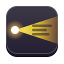

<div align="center">



# Keyway

**Instant search and actions for GNOME.**<br>
*The keyboard way to everything on your desktop.*

</div>

Keyway is a keyboard-first command bar for GNOME. Press a shortcut, type a few letters, and
Keyway finds what you mean: an app, an open window, a file, a setting, a calculation or a
system command. Settings are results you can **operate**: typing `dark` shows a live
*Dark Style* switch, typing `vol 30` sets the volume, and `Ctrl+Z` undoes the change.

> [!NOTE]
> Keyway is in **Phase 0 (bootstrap)**. Nothing is usable yet. The roadmap is in
> [docs/PLAN.md §35](docs/PLAN.md#35-roadmap-and-phases).

## Design in brief

| Component | Language | Role |
|---|---|---|
| GNOME Shell extension | GJS | Draws the bar and runs Shell-side actions; does no searching |
| `keyway-engine` | Rust, GIO only | Search, ranking, catalog and actions, outside the compositor; D-Bus-activated and exits when idle |
| `keyway` | Rust, GTK 4 + libadwaita | Preferences, onboarding and diagnostics |
| `keywayctl` | Rust | Queries, benchmarks and health checks from the command line |

Keyway targets GNOME 50 and 51 on Wayland, uses only freedesktop and GNOME standards, sends
nothing anywhere and contains no AI. The full specification is [docs/PLAN.md](docs/PLAN.md);
architecture decisions are in [docs/adr/](docs/adr/).

## Development

The development environment is installed as one removable unit (Ubuntu 26.04 or later):

```bash
scripts/setup/install-system-deps.sh
```

```bash
scripts/setup/install-user-tools.sh
```

```bash
just doctor
```

The first script installs the `keyway-dev-env` metapackage, which depends on every host tool
the project needs. The second installs the Rust toolchain and cargo tools into `~/.rustup` and
`~/.cargo`. To remove everything again:

```bash
scripts/setup/uninstall.sh
```

Everyday commands are `just setup`, `just build`, `just check` and `just test`. See
[CONTRIBUTING.md](CONTRIBUTING.md) before opening a pull request.

## License

Code is licensed under [GPL-3.0-or-later](LICENSES/GPL-3.0-or-later.txt). The action catalog,
synonym dictionaries, artwork and documentation are licensed under
[CC-BY-SA-4.0](LICENSES/CC-BY-SA-4.0.txt), and metadata and configuration under
[CC0-1.0](LICENSES/CC0-1.0.txt). The project follows the [REUSE](https://reuse.software)
specification.
