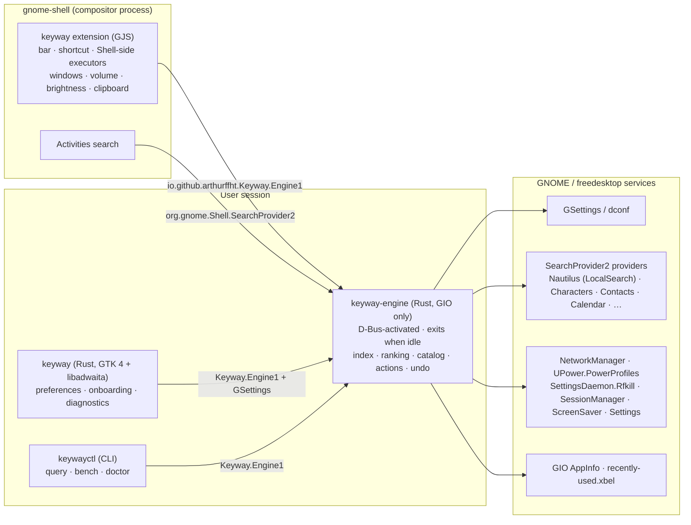

# Keyway — Master Plan

**Instant search and actions for GNOME.**
*The keyboard way to everything on your desktop.*

| Field | Value |
|---|---|
| Document | Master plan, technical specification and bootstrap runbook |
| Version | 1.0 |
| Date | 2026-10-21 |
| Status | Ready for bootstrap, pending the maintainer decisions listed in §37 |
| Audience | The maintainer, and every Claude Code session that works on this project |
| Supersedes | The earlier Portuguese drafts ("Farol", "Lampejo"), now archived |
| Reference machine (measured) | Ubuntu 26.10 · GNOME Shell 51.0 · GTK 4.24.1 · libadwaita 1.10.0 · GLib 2.90.0 · GJS 1.90.0 · GNU gettext 1.0 |
| Platform support | GNOME 50 and 51 at launch; every later GNOME release, through GNOME 58 and beyond, under the policy in §33 |

---

## How to read this document

**Maintainer.** Part I explains what Keyway is and why it is worth building. The decisions that need you are collected in §37. Everything else has a recommended default that applies unless you override it.

**Claude Code.** Read §0 and Appendix A (`CLAUDE.md`) first. Then execute the Phase 0 runbook in §35.1 step by step, and stop at every step marked **GATE** to ask the maintainer. Later phases are driven by GitHub issues created from §35.

**Conventions.**
- MUST, SHOULD and MAY follow RFC 2119.
- **VERIFY** marks a statement that has not yet been confirmed against a primary source. Confirm it before code depends on it, and record the result in `docs/verification-ledger.md`. Appendix N seeds that ledger.
- Facts marked *measured* were observed directly on the reference machine on 2026-10-21.
- The maintainer's GitHub username is `arthurffht` (confirmed 2026-10-21). Its normalized form for reverse-DNS IDs is also `arthurffht` (§2.2).

---

## Executive summary

| Topic | Decision |
|---|---|
| Product | A Spotlight-style bar for GNOME. It finds apps, windows, files and settings, does calculations and conversions, and **changes system settings in place** with live switches, sliders and undo |
| Name | **Keyway**, confirmed by the maintainer. Automated availability checks passed; a manual trademark search is pending (§2.3) |
| Architecture | Thin GNOME Shell extension for the UI (GJS) + out-of-process engine (Rust, GIO only, D-Bus-activated) + preferences app (Rust, GTK 4, libadwaita, Blueprint) |
| Why out of process | The Shell is the compositor, so extension code runs on the same loop that draws every frame. Keyway keeps all work that can block off that loop |
| Footprint target | Engine at most 16 MiB RSS while active and zero while idle, because it exits after inactivity. Measured GIO daemons on this machine use 8–14 MiB RSS |
| Integration | Only freedesktop and GNOME standards: desktop entries, desktop actions, `SearchProvider2`, GSettings, GActions and the D-Bus services the Shell itself uses. No per-app hacks |
| AI | **None in the product.** Questions can be handed off to the user's chosen web search or assistant through a URL |
| Quality | Twelve automated test suites (§26), deterministic performance gates, ranking-quality metrics and an end-to-end test that runs a real headless GNOME Shell |
| Compatibility | Release within 14 days of each GNOME `.0`, a weekly canary against GNOME nightly, runtime capability probing, and a policy for the GNOME 50 LTS (§33) |
| Distribution | Native packages first (PPA, COPR, AUR) plus extensions.gnome.org. Flatpak only for the preferences app, later |
| Language | English (US) is the source language for code, documentation and UI. Translations go through gettext and are always reviewed by people |
| Development | Claude Code does the implementation under strict rules. The maintainer owns decisions, reviews every PR, and owns the extension's code as EGO policy requires (§31.6) |

---

## 0. Operating rules for automated work

These rules bind every Claude Code session on this project. They are repeated in Appendix A.

1. **Never change the live desktop session.** Do not run `gsettings set`, `dconf write` or `dconf reset`, and do not run `gnome-extensions enable`, `disable` or `install` against the host session. Use the isolated headless shell (§26.6) or the development shell with its separate dconf profile (§30.4).
2. **Never take these actions without explicit approval from the maintainer in chat:** pushing to `main`, merging PRs, publishing releases, changing repository settings, creating repositories, or submitting to extensions.gnome.org, Flathub, Launchpad, COPR or AUR.
3. **Verify every platform API before using it.** Check GLib, GIO, GTK, libadwaita, St, Clutter, Meta and Shell APIs against the official documentation or the installed sources (§31.6.6). Never guess an API.
4. **One concern per change.** Keep PRs under about 400 changed lines. Code comes with tests, benchmarks when the change touches a hot path, and documentation.
5. **Proof before "done".** A task is complete only when the commands in its Definition of Done (§35.6) have run and passed, and their output is quoted in the PR.
6. **Disclose AI assistance** as §31.6.2 defines.
7. **When a requirement is ambiguous, ask.** Do not invent product behaviour.

---

# Part I — Product

## 1. Summary

Keyway is a keyboard-first command bar for the GNOME desktop. Press a shortcut and a slim bar appears at the top of the screen. Type a few letters and Keyway finds what you mean: an app, an open window, a file found by name or by its content, a setting, a calculation, an emoji or a system command. Press Enter to act.

What sets Keyway apart is that settings are results you can **operate**. Typing `dark` shows a live *Dark Style* switch. Typing `vol 30` shows the volume slider already set to 30 %. Every reversible change can be undone with `Ctrl+Z`.

Keyway follows the GNOME Human Interface Guidelines and inherits the system's own widgets and styling. It runs locally, sends nothing anywhere, and costs nothing when you are not using it.

## 2. Name and identity

### 2.1. Keyway

In a lock, the **keyway** is the shaped channel the key slides into: the single entry point that opens the mechanism. In mechanical engineering, a keyway is the slot that locks a part to a rotating shaft so the two move as one. Read plainly, the word is *key way*: the keyboard way to everything on your desktop.

| GNOME HIG naming criterion (one or two simple nouns, under 15 characters, easy to say, easy to pair with an icon) | Keyway |
|---|---|
| Simple noun | Yes |
| Length | 6 characters |
| Easy to pronounce in any language | "KEE-way" |
| Pairs with an icon | A keycap carrying a path or arrow (§24) |
| Searchable, not generic | Yes. It is not a "-light" name; GNOME already has Search Light, Quick Light, Searchlight and Spotlight clones |
| No AI connotation | Yes |
| Collisions found (2026-10-21) | None among desktop apps, GNOME extensions or Linux packages. A few small developer-security projects use the name, most visibly the `keywaysh` secrets-management tool (§2.3). This is **not** a trademark clearance |

Names that were considered and rejected:
- *Lampejo* and *Farol*: Portuguese.
- *Footlight*: a "-light" name, and an existing macOS lighting console.
- *Findspot*: an existing macOS file finder.
- *Signpost*: an existing link chooser for the COSMIC desktop.
- *Wayfinder*: collides with the Wayland tools Wayfire and Wayfarer, and with a video game.
- *Cairn*: an existing GNOME task manager in the AUR.

### 2.2. Identifiers

Reverse-DNS IDs use the GitHub username normalized: lowercased, with every `-` replaced by `_`, and prefixed with `_` if it starts with a digit, because D-Bus interface names and object paths cannot contain hyphens. For `arthurffht` the normalized form is identical.

| Item | Value |
|---|---|
| Public name | Keyway |
| Application ID (preferences app, desktop file, icon, metainfo) | `io.github.arthurffht.Keyway` |
| Development application ID | `io.github.arthurffht.Keyway.Devel` |
| Engine D-Bus name | `io.github.arthurffht.Keyway.Engine` |
| Engine object path | `/io/github/arthurffht/Keyway/Engine` |
| Engine interface | `io.github.arthurffht.Keyway.Engine1` |
| Search provider object path | `/io/github/arthurffht/Keyway/Engine/SearchProvider` |
| GSettings schema | `io.github.arthurffht.Keyway` |
| Extension UUID | `keyway@arthurffht.github.io` |
| gettext domain | `keyway` |
| Binaries | `keyway-engine` (in `libexecdir`), `keyway` (app), `keywayctl` (diagnostics CLI) |
| Log domain (`G_MESSAGES_DEBUG`) | `keyway` |
| Repository | `github.com/arthurffht/keyway` |
| AppStream summary | "Search and act instantly" |

The development profile uses the `.Devel` application ID, as GNOME applications do, so a development build can be installed next to a released one.

### 2.3. GATE — name availability check

Before the repository is created, the maintainer and Claude MUST complete and record this check in `docs/naming.md`:

- [x] GitHub repositories (`gh search repos keyway --limit 50`, or the public search API)
- [x] extensions.gnome.org search for "keyway"
- [x] Flathub search for "keyway"
- [x] crates.io (`https://crates.io/api/v1/crates/keyway`)
- [x] npm (informational only)
- [ ] Domains such as `keyway.app` and `keyway.dev` (optional)
- [ ] Trademark databases in classes 9 and 42: USPTO, EUIPO, and INPI for Brazil (manual)
- [x] Ubuntu, Debian, Fedora, Arch and AUR package indexes, and the Snap Store

**Results of the automated checks (2026-10-21).** Copy them into `docs/naming.md` in Phase 0.

| Channel | Result |
|---|---|
| GitHub account `arthurffht` | Exists |
| Repository `arthurffht/keyway` | Free |
| GitHub repositories named "keyway" | 95 matches, all small. The most visible: `keywaysh/keyway` (GitHub-native secrets management, 12 stars, active in 2026), `HalxDocs/keyway` (SSO library for Go), `Keyway-AI/keyway` (JWT key-rotation tooling) and `TrevorS/keyway` (Bash lock files, 2016). None is a desktop or GNOME project |
| crates.io `keyway` | Free |
| npm `keyway` | Taken by an unrelated 2022 utility library; irrelevant, because Keyway publishes nothing to npm |
| extensions.gnome.org | No extension named Keyway |
| Flathub | No app named Keyway |
| Snap Store | Free |
| Arch Linux (official and AUR) | Free |
| Debian sources | Free |
| Fedora (rawhide) | Free |
| Ubuntu archive | Free |
| Trademark databases (USPTO, EUIPO, INPI) | **Pending: manual search by the maintainer before the Phase 3 public demo** |
| Domains | Optional; not checked |

**Assessment.** "Keyway" is free in every channel the project ships through. The other projects using the word are developer-security tools in a different market. The remaining risk is a registered trademark held by one of them, which the manual trademark search resolves before anything is announced publicly.

If a check fails, use the fallbacks in this order: **Peregrine** (the fastest bird on Earth, with exceptional sight), then **Beckon** (to summon with a gesture). Apply the same check to the fallback.

### 2.4. Messaging

- **Tagline:** "The keyboard way to everything on your desktop."
- **One-line description:** "Find apps, files and settings — and change them — in a few keystrokes."
- **Positioning:** "A native GNOME command bar: instant, private, and as light as the system's own services."

## 3. Problem and opportunity

- **macOS 26 Spotlight** turned search into a place for **actions**. It runs hundreds of system and app actions, supports learned Quick Keys, keeps an opt-in clipboard history (8 hours by default) and lets apps expose actions through App Intents. Users switching from a Mac expect this.
- **Windows 11** maps natural language to settings with a small on-device model (Mu, 330 M parameters). In October 2026, however, Microsoft paused "Ask Copilot" in the taskbar after strong user rejection. **Lesson: people want fast, direct control, not forced AI.**
- **GNOME's Activities search** finds apps, files and settings panels. It does not operate settings in place, offer undo, show live controls or appear as a floating bar.
- **GNOME 50 removed X11**, and Mutter does not implement `wlr-layer-shell`. A floating bar on GNOME therefore requires a Shell extension, which explains why every existing project in this space is either an extension or a standard window.

## 4. Competitive landscape

The GNOME launcher space is **crowded**. Keyway is worth building only if it is clearly better on the axes below.

| Project | Form | What it offers | Observed limits |
|---|---|---|---|
| Activities search (built-in) | Shell | Apps, files, settings panels, third-party providers | Full-screen overview; no in-place controls, actions or undo |
| Spotlight (itsnin, EGO 10666) | Extension | Apps, files ranked by usage, calculator, lock and suspend, Settings panels, web search; GNOME 45–51 | All logic runs in the Shell process; an EGO review flagged its version metadata (EGO-M-004) |
| Search Light (icedman) | Extension | Overview search in a floating popup, appearance options | Reuses overview search; no actions |
| Hop Launcher | Extension | Apps, windows, recents, files, clipboard, weather, web | Early versions rejected on EGO |
| Quick Light, Lightning, Rudra, Raccoon Launcher | Extensions | Variations of app, file and web search | Small single-maintainer projects |
| Searchlight (kieranpaul81) | `.deb` app | Apps, files, actions, calculator, optional clipboard | Ubuntu-only; standard window |
| Vicinae | Native app (Raycast-compatible) | Rich launcher with Raycast extensions | Needs a third-party Shell extension on GNOME Wayland; not GNOME-styled |
| Àwárí | Daemon + overlay | Frecency index of windows, apps and files | Built for `wlr-layer-shell`; falls back to a normal window on GNOME |
| Ulauncher, Albert | Native apps | Mature plugin ecosystems | Not GNOME-native in look or integration |

App search, file search, a calculator and web search are **table stakes**: every competitor has them. Keyway's case rests on seven differentiators:

1. **The compositor stays smooth.** All indexing, ranking, provider calls and I/O run outside the Shell. Competitors that search inside the Shell share the compositor's main loop.
2. **Deep, operable settings.** Hundreds of individual settings appear as live controls, with undo. Competitors open settings panels; Keyway changes the setting.
3. **It works without the extension.** The engine is also a standard GNOME search provider, so Keyway's actions appear in Activities even when a GNOME upgrade temporarily disables extensions.
4. **It integrates through standards.** Every installed app with a search provider, desktop actions or D-Bus actions participates automatically.
5. **Measured performance.** Budgets are enforced in CI, and benchmark results are published with each release.
6. **Engineered to last.** Runtime capability probing, a compatibility layer, a weekly canary against GNOME nightly and a release-per-cycle commitment (§33).
7. **Accessible and international.** Orca support, keyboard-only use, gettext translations and native-speaker synonym dictionaries.

**Kill criteria** are evaluated at the Phase 3 gate (§35.4). If the public demo draws no meaningful interest, the project pivots or stops before the expensive phases.

## 5. Scope

### 5.1. Goals for 1.0

- A floating bar summoned by a shortcut, on GNOME 50 and 51 under Wayland.
- These sources: apps and app actions, open windows, about 250 settings and actions with live controls and undo, files by name and content, recent files, calculator and unit conversion, system information, session commands, emoji, third-party search providers, and web and assistant handoff.
- An opt-in clipboard history that is kept in memory only.
- Learned ranking (frecency and prefix associations) and user-defined Quick Keys.
- Keyway's actions in Activities search through `SearchProvider2`.
- A preferences app covering onboarding, sources, shortcuts, privacy and diagnostics.
- English source text, with a human-reviewed Brazilian Portuguese translation at 1.0.
- Packages for Ubuntu 26.04 and 26.10, Fedora 44 and 45, Arch, and extensions.gnome.org.

### 5.2. Non-goals

- Generative AI or on-device models.
- A file indexer of its own. Keyway uses LocalSearch through the existing providers.
- X11 sessions, desktops other than GNOME, or theming the Shell.
- Running arbitrary shell commands in 1.0. This may be revisited after 1.0, with confirmation, under its own ADR.
- Destructive actions: permanent deletion, emptying the trash, or root commands.
- Telemetry of any kind.

### 5.3. After 1.0

- **App Actions**: an open specification that lets apps declare actions as data, executed through GActions (§13.8).
- Direct LocalSearch queries with filters ("pdf last week").
- Currency conversion with opt-in daily rates.
- Snippets.
- More translations.
- A Flatpak of the preferences app.
- A proposal to the GNOME project.

## 6. Product principles

1. **Speed is a feature.** No keystroke ever waits on disk, network or another process.
2. **Verbs, not only nouns.** Finding the sound panel is good; setting the volume right there is better.
3. **Looks like GNOME because it is GNOME.** Keyway reuses the Shell's own widgets and style classes.
4. **Every change is visible and reversible.** Reversible actions are undoable, and actions that end the session go through GNOME's own confirmation dialogs.
5. **Private by construction.** There is no account, no server and no telemetry. Data leaves the machine only when the user explicitly hands a query to the web.
6. **Nothing runs uninvited.** Keyway does no polling and shows no tips or prompts, and the engine exits when idle.
7. **It learns without watching.** Usage-based ranking is stored locally, can be inspected, and can be erased.
8. **Standards over special cases.** Keyway integrates with every app through freedesktop and GNOME interfaces.
9. **It lasts.** Compatibility is a process, not a hope.

---

# Part II — Architecture

## 7. System overview



| Component | Language | Owns | Never does |
|---|---|---|---|
| Extension | GJS (ESM) | The bar UI, the shortcut, modal grab, rendering, and Shell-side actions: launching apps, focusing windows, volume, brightness, clipboard observation | Indexing, ranking, file I/O, network, blocking calls |
| `keyway-engine` | Rust | Sources, normalization, matching, ranking, the catalog, action backends, undo, state, search provider | Linking GTK, drawing UI, keeping work on a timer |
| `keyway` | Rust | Settings UI, onboarding, diagnostics view | Executing actions (it always goes through the engine) |
| `keywayctl` | Rust | Scripted queries, benchmarks, health checks | Being required at runtime |

## 8. Architecture decisions

Each decision is recorded as an ADR in `docs/adr/` using the MADR 4 template. Initial set:

| ADR | Decision | Rationale |
|---|---|---|
| 0001 | Record decisions as MADR files | Traceable reasoning for every contributor |
| 0002 | The overlay is a GNOME Shell extension | Mutter has no `wlr-layer-shell` and apps cannot position windows on Wayland. The GlobalShortcuts portal (GNOME 48+) solves shortcuts but not placement |
| 0003 | All search, ranking and action logic runs out of process | Extension code runs on the compositor's main loop, where blocking work drops frames. A separate process also isolates crashes and makes the engine testable |
| 0004 | The engine links GIO only, never GTK | *Measured:* GIO-only daemons (`gsd-*`) use 8–14 MiB RSS, while GJS services use 31–35 MiB. Initializing GTK adds cost for nothing the engine needs |
| 0005 | The engine is a D-Bus-activated `GApplication` service with an inactivity timeout | This is the standard GNOME pattern for search providers, and it means zero resident cost when idle |
| 0006 | D-Bus through GDBus (`gio`), not `zbus` | One main loop for D-Bus, GSettings and file monitors, and no extra executor threads |
| 0007 | No database. User configuration lives in GSettings; learned state in one small JSON file written atomically | Fewer dependencies, trivially inspectable, and a clipboard that never touches disk |
| 0008 | The catalog and synonym dictionaries are compiled into the binary (`build.rs` + `phf`) | Startup does no parsing, and invalid data fails the build instead of reaching users |
| 0009 | Reuse existing indexes and providers | LocalSearch already indexes names and content, so a second indexer would only duplicate I/O |
| 0010 | The Shell (extension) activates apps, windows and URIs; the engine returns **intents** | Correct activation tokens, startup notification and focus behaviour on Wayland |
| 0011 | Meson is the top-level build, with Cargo below it; UI is written in Blueprint | This is how GNOME's Rust apps are built. Meson installs schemas, desktop files, D-Bus services, icons, translations and the extension |
| 0012 | Native packages first; Flatpak only for the preferences app, later | The product depends on a Shell extension and host settings, which the Flatpak sandbox cannot provide |
| 0013 | No generative AI in the product | Out of scope; see §3 for the evidence from Windows |
| 0014 | English (US) source strings, gettext, Weblate, human-reviewed translations | GNOME's standard practice |
| 0015 | Minimum platform: GNOME 50 (GTK 4.22, libadwaita 1.9) and Rust 1.93 | Ubuntu 26.04 LTS ships GNOME 50 with Rust 1.93.1, and is supported until 2031 |
| 0016 | A single `main` branch with a compatibility layer; an LTS branch only when keeping GNOME 50 costs more than the threshold in §33.5 | Keeps maintenance cheap |

## 9. Technology stack

### 9.1. Languages and toolchains

| Tool | Version policy | Notes |
|---|---|---|
| Rust | Edition 2024. **MSRV 1.93** (Ubuntu 26.04 ships 1.93.1; Ubuntu 26.10 ships 1.97.1, *measured*). `rust-toolchain.toml` pins the latest stable at bootstrap for development and linting | CI also builds with each distribution's own `rustc`, which is what packagers use |
| GJS | As shipped by the GNOME version (GJS 1.90 on GNOME 51, *measured*) | ESM only, which has been mandatory since GNOME 45 |
| Blueprint | `blueprint-compiler` 0.20.4 on Ubuntu 26.10 (*measured*). **VERIFY** the version on Ubuntu 26.04 | Included in the GNOME SDK since GNOME 49 |
| Meson | 1.10.1 on Ubuntu 26.10 (*measured*). Set `meson_version: '>= 1.4'` and **VERIFY** the version on 26.04 | Top-level build |
| gettext | 1.0 on Ubuntu 26.10 (*measured*). `xgettext` has supported Rust since gettext 0.24 | No string-extraction workarounds needed |
| Node.js and npm | 24.19 and 11.16 (*measured*) | Development only: ESLint and type checking for the extension |
| Python | Development only | Used just for `python3-dbusmock` (0.38.1, *measured*), the standard way to mock system services in GNOME tests |

### 9.2. Platform libraries

| Library | Minimum (GNOME 50) | Reference (GNOME 51) | Binding |
|---|---|---|---|
| GLib / GIO | GNOME 50 release (**VERIFY**: 2.88) | 2.90.0 (*measured*) | `glib`, `gio` 0.22 |
| GTK | 4.22 | 4.24.1 (*measured*) | `gtk4` 0.11 (app only) |
| libadwaita | 1.9 | 1.10.0 (*measured*) | `libadwaita` 0.9.2 with the `v1_9` feature (app only) |

### 9.3. Crates

| Crate | Purpose | License | Notes |
|---|---|---|---|
| `glib`, `gio` 0.22 | Main loop, GDBus, GSettings, AppInfo, file I/O | MIT | Official gtk-rs |
| `gtk4` 0.11, `libadwaita` 0.9 | Preferences app | MIT | **VERIFY** the gtk4 feature name for 4.22 |
| `nucleo-matcher` 0.3 | Fuzzy matching with fzf-style scoring and correct grapheme handling | MPL-2.0 | Benchmarked against `frizbee` (SIMD, typo-tolerant) in Phase 1; ADR-0017 records the result |
| `unicode-normalization` | NFKD decomposition and combining-mark detection | MIT/Apache-2.0 | Diacritic folding |
| `phf` | Compile-time perfect-hash maps for the catalog and synonyms | MIT | Zero-cost lookup |
| `fend-core` 1.5 | Arbitrary-precision, unit-aware calculator | MIT | No dependencies |
| `serde`, `serde_json`, `toml` (build only) | State file and catalog parsing | MIT/Apache-2.0 | `toml` is only a build dependency |
| `quick-xml` | Reading `recently-used.xbel` | MIT | Streaming parser |
| `thiserror` | Typed errors | MIT/Apache-2.0 | No `anyhow` in libraries |
| `gettext-rs` | Translations | MIT | Same catalogs as the rest of GNOME |
| *Development:* `proptest`, `insta`, `gungraun` (formerly `iai-callgrind`), `divan`, `cargo-fuzz` tooling | Tests and benchmarks | Various permissive licenses | Never in release binaries |

**Dependency budget.** The engine SHOULD stay under 60 transitive crates. Every new dependency needs a PR that justifies its size, license and maintenance status, and `cargo deny` enforces the license allowlist (Appendix G).

**Excluded on purpose:** Tokio and other async runtimes, SQLite, Electron and other web stacks, UI frameworks layered on GTK (such as Relm4), and any machine-learning library.

## 10. Engine: `keyway-engine`

### 10.1. Responsibilities

- Answer `Keyway.Engine1` and `SearchProvider2` requests.
- Keep in-memory indexes of apps, the catalog, recent files and the clipboard (when opted in).
- Aggregate external search providers under strict timeouts.
- Execute catalog actions through backends, and keep an undo journal.
- Learn from usage (frecency and prefix associations) and persist that state.
- Report diagnostics.

### 10.2. Process model and lifecycle

```text
login ............................ nothing runs
first shortcut press ............. extension calls OpenSession → D-Bus activates the engine
                                   (budget: ≤ 40 ms from activation to the first reply)
typing ........................... Search() on every keystroke: local results answered synchronously
                                   (p95 ≤ 2 ms); external results follow as ResultsAppended signals
bar closed ....................... CloseSession; the engine holds for engine-idle-timeout (default 600 s)
idle timeout ..................... process exits; resident cost is zero
clipboard history enabled ........ the engine stays resident; history lives only in its memory
```

- The engine is a `gio::Application` with `ApplicationFlags::IS_SERVICE`, activated by `share/dbus-1/services/io.github.arthurffht.Keyway.Engine.service` (Appendix M).
- It holds the application while sessions are open or the clipboard is enabled, and releases it otherwise. GApplication's inactivity timeout handles the exit.
- `SIGTERM` flushes state atomically and exits.

### 10.3. Threading and I/O rules

- **One thread, one loop:** the default `glib::MainContext`.
- Local sources are pure in-memory work and run synchronously inside `Search()`.
- All I/O is asynchronous GIO: provider calls, D-Bus property reads, and file reads and writes.
- A worker thread is allowed only for CPU-bound jobs over 1 ms, and none exists in 1.0. Adding one requires an ADR.
- Every asynchronous operation carries a `gio::Cancellable` tied to the session and the query serial.

### 10.4. Workspace layout

```text
crates/
├── keyway-core       pure Rust, no GLib: normalization, query parsing, matching, scoring,
│                     frecency, associations, result model
├── keyway-catalog    build.rs compiles actions/*.toml + locales/*/synonyms.toml into static
│                     tables; runtime types for catalog entries
├── keyway-calc       fend-core wrapper: locale-aware number parsing, unit and duration helpers
├── keyway-platform   GIO: app index, recent files, provider aggregation, action backends,
│                     capability probing, D-Bus clients for system services
├── keyway-engine     binary: GApplication service, Engine1 + SearchProvider2 servers, sessions,
│                     state, undo journal, diagnostics
├── keyway-app        binary: GTK 4 + libadwaita preferences app, Blueprint UI
├── keywayctl         binary: CLI client and offline benchmark runner
└── keyway-testkit    development only: isolated D-Bus, GSettings memory backend,
                      dbusmock launcher, golden-corpus runner, Shell e2e driver
```

**Dependency rule:** `core` and `calc` know nothing about GLib. `platform` knows nothing about the engine's D-Bus API. Only `keyway-engine` assembles the pieces. CI enforces this with `cargo tree` checks.

### 10.5. Core data model (sketch)

```rust
pub struct Candidate {
    pub id: ResultId,               // stable, namespaced: "app:org.gnome.Nautilus.desktop", "setting:appearance.dark-style"
    pub kind: Kind,                 // App, AppAction, Window, Setting, Action, File, Calculation, Emoji, Provider, Command, Clipboard, Handoff
    pub title: Box<str>,
    pub subtitle: Option<Box<str>>,
    pub icon: IconRef,              // serialized GIcon string: themed name or file URI
    pub control: Control,
    pub source: SourceId,
    pub highlights: SmallRanges,    // byte ranges in `title` that matched, for bold rendering
}

pub enum Control {
    None,
    Switch { on: bool },
    Slider { value: f64, min: f64, max: f64, step: f64 },
    Choice { selected: u16, options: &'static [ChoiceOption] },
}
```

Local sources implement a synchronous trait that writes into a reusable candidate buffer. External sources implement an asynchronous trait that delivers batches to a sink tied to the session. Both traits have several implementations, so neither is a speculative abstraction.

### 10.6. Sessions

A session is the lifetime of one open bar. `OpenSession(context)` receives the Shell-provided context once: open windows (id, title, app id), the monitor scale, the Shell's capabilities (`volume`, `brightness`, `windows`, `clipboard`) and the locale. Keystrokes then send only `(session, serial, query)`. Sessions expire 30 s after the last call, which protects against a Shell that disappears without closing them.

### 10.7. State persistence

- **Learned state:** `$XDG_STATE_HOME/keyway/state.json`. It holds a schema version, frecency entries, prefix associations and the undo journal (the last 50 entries).
- Writes use `gio::File::replace_contents` (atomic), are debounced to at most one every 5 s, and are flushed on exit.
- A corrupted file is renamed to `state.json.corrupt-<timestamp>`, and Keyway starts fresh. It never crashes because of state.
- **User configuration** lives in GSettings (§17), so GNOME's own tools can back it up and restore it.

### 10.8. Undo journal

Before every reversible change, Keyway records an entry `{token, action_id, previous_value, new_value, timestamp}`. `Undo(token)` restores the previous value only if the current value still equals `new_value`. If the user has changed it in the meantime, Undo reports that instead of overwriting their change.

### 10.9. Capability probing

The catalog is written once, while platforms differ. At startup and on change, the engine probes:

- **GSettings:** `gio::SettingsSchemaSource::default()` → `lookup(schema, true)` → `has_key(key)`. A missing schema or key hides the action.
- **D-Bus services:** activatable names and current owners, watched with `bus_watch_name`. A missing service hides its actions, and they reappear when the service appears.
- **Shell capabilities:** taken from the session context. Without the extension (for example in Activities mode), Shell-only actions are hidden.
- **Desktop:** `XDG_CURRENT_DESKTOP` must contain `GNOME`. Elsewhere, only generic sources are offered.

This is what lets one catalog run correctly on GNOME 50, 51 and future releases. Keys that GNOME adds or removes simply turn actions on or off.

### 10.10. Diagnostics

The engine keeps in-memory histograms (p50, p95, p99) per source and per method, plus counters, current memory usage (from `/proc/self/smaps_rollup`), capabilities, provider health and the versions in use. `GetDiagnostics()` returns them; the preferences app displays them; `keywayctl doctor` prints them. Nothing is written to disk.

### 10.11. Logging

Keyway uses GLib structured logging with the log domain `keyway`. By default it logs only warnings and errors. **Query text and result titles are never logged**, even at debug level; debug logs use counts and identifiers only. Logs go to the journal.

### 10.12. Error model

- `keyway-core` uses `thiserror` enums.
- D-Bus errors are mapped to registered names: `io.github.arthurffht.Keyway.Engine1.Error.{InvalidSession, UnknownResult, Unsupported, Busy, Failed}`.
- Backend failures become user-facing messages that say what to do next, for example "Wi-Fi is controlled by your administrator".

### 10.13. Input limits

To protect against misbehaving clients:

| Input | Limit |
|---|---|
| Query | 512 bytes |
| Session context | 64 KiB |
| Window list | 256 windows |
| Clipboard entry | 64 KiB of text |
| Clipboard history | 100 entries |

Inputs over a limit are rejected with `Error.Failed` and are never truncated silently.

## 11. Search pipeline and ranking

### 11.1. Normalization

Haystacks are normalized once, at index time; the query is normalized on every keystroke.

1. Apply Unicode NFKD, then remove combining marks (`unicode_normalization::char::is_combining_mark`).
2. Lowercase.
3. Fold letters that do not decompose (`ß→ss`, `æ→ae`, `ø→o`, `ł→l`, `đ→d`).
4. Collapse whitespace and treat punctuation as separators.

As a result, `configuracoes`, `Configurações` and `CONFIGURAÇÕES` are equivalent.

### 11.2. Query grammar

```text
query      := scope? body
scope      := "=" (calculator) | "/" (settings) | "@" (files) | ">" (commands)
            | "?" (web and assistant) | ":" (emoji)
body       := free text, optionally with a value
value      := number ["%"] | duration ("10 min", "1h30", "2 h") | unit expression ("5 in to cm")
```

- Values attach to actions that accept them: `vol 30` sets the volume to 30 %, `dnd 1h` turns on Do Not Disturb for one hour, and `timer 10 min` starts a timer.
- Number parsing follows the locale. In `pt_BR`, `1,5` means one and a half.

### 11.3. Matching tiers

| Tier | Example | Base score |
|---|---|---|
| Quick Key, exact | `dk` → Dark Style (user-defined) | 1000 |
| Title, exact | `files` → Files | 950 |
| Title, prefix | `nig` → Night Light | 900 |
| Word prefixes in order | `ni li` → Night Light | 850 |
| Initials | `nl` → Night Light | 800 |
| Synonym, exact | `tela quente` → Night Light (pt_BR) | 780 |
| Synonym, prefix | `tela qu` → Night Light | 740 |
| Keyword, prefix (desktop `Keywords=`, catalog keywords) | `browser` → Firefox | 700 |
| Title, substring | `light` → Night Light | 650 |
| Fuzzy (nucleo, normalized to 0–1, × 600) | `bluetoth` → Bluetooth | ≤ 600 |
| External provider rank r of n | Nautilus results | 500 − 200·r/n |

### 11.4. Scoring

```text
score = base × kind_weight + frecency_bonus + association_bonus + context_bonus

kind_weight        app 1.00 · setting/action 1.00 · window 0.97 · file 0.88 · provider 0.82 · handoff 0.10
frecency_bonus     120 · ln(1 + f)               f = decayed use count of the result (§11.5)
association_bonus  min(240, 200 · ln(1 + a))     a = decayed count of this prefix choosing this result (§11.6)
context_bonus      small, local, explainable: +40 for power actions on battery, +40 for audio outputs
                   while a headset is connected; never anything derived from tracking behaviour
ties               kind priority → shorter title → result id (deterministic, so snapshots stay stable)
```

The engine selects the top results with `select_nth_unstable_by` and sorts only those (k ≤ 12). The weights are tuning parameters owned by the golden-corpus tests (§11.10), not by intuition.

### 11.5. Frecency

Each result stores `(f, t_last)`. When it is used at time `t`:

```text
f ← f · 2^(−(t − t_last) / H) + 1,   with half-life H = 14 days
```

Reading `f` applies the same decay. This needs one number per result and an O(1) update, and it forgets old habits smoothly.

### 11.6. Learning without AI: prefix associations

When the user types the prefix `p` (normalized, 1–8 characters) and chooses result `r`, the weight `a(p, r)` is increased with the same decay as frecency. The table is bounded to the 4,096 most recent pairs (LRU). This is how `d` comes to mean *Dark Style* for one user and *Documents* for another: deterministic, local and inspectable. Users can turn it off (`learn-from-usage`) and erase it.

### 11.7. Quick Keys

Quick Keys are explicit shortcuts defined by the user (`dk` → Dark Style), stored in GSettings. When a prefix has chosen the same result five times in 14 days with at least 80 % consistency, the bar offers a one-line suggestion in its footer. The suggestion never interrupts the user.

### 11.8. Stability and merging

- External batches are merged **below** the current selection, so the selected row never moves.
- External sources are not queried for queries shorter than 3 characters.
- Each provider has a 150 ms timeout, and results that arrive later are dropped for that serial.

### 11.9. Empty query

An empty query shows up to five suggestions ranked by frecency (recent apps, settings and files) and the Quick Key hint. It shows no web content.

### 11.10. Ranking quality metrics

Each locale has a golden corpus (`tests/queries/<locale>.toml`) of real queries collected from testers, each with its expected result. CI computes:

| Metric | 1.0 threshold | Regression gate per PR |
|---|---|---|
| Top-1 accuracy | ≥ 90 % | No drop greater than 0.5 percentage points |
| Top-3 accuracy | ≥ 98 % | No drop greater than 0.5 percentage points |
| Mean reciprocal rank | ≥ 0.93 | No drop greater than 0.005 |

Every failed query found during the beta becomes a corpus entry.

## 12. Result sources

| Source | Data and API | Capability probe | Phase |
|---|---|---|---|
| Apps | `gio::AppInfo::all()` + `DesktopAppInfo` (name, generic name, keywords, `Actions=`), filtered by `should_show()`; `AppInfoMonitor` for changes. Flatpak exports and Snap desktop directories arrive automatically through `XDG_DATA_DIRS` | Always available | 1 |
| Settings and actions | Compiled catalog (§13) | Per entry (§10.9) | 2 |
| Windows | Context provided by the extension | `windows` capability | 3 |
| Calculator and units | `fend-core`, with locale-aware number parsing | Always available | 4 |
| Files | `org.gnome.Nautilus` `SearchProvider2` (backed by LocalSearch: name and content). Object path **VERIFY** (`/org/gnome/Nautilus/SearchProvider`) | Provider present | 4 |
| Recent files | `$XDG_DATA_HOME/recently-used.xbel` via `quick-xml`, watched with `gio::FileMonitor` | File present | 4 |
| Emoji | GNOME Characters search provider (bus name and path **VERIFY**) | Provider present | 4 |
| Other providers | Every installed `SearchProvider2` provider (§12.1) | Provider present and enabled | 4 |
| System information | UPower (battery), NetworkManager (connectivity, IP), `os-release`, filesystem usage (GIO) | Per service | 4 |
| Session commands | Lock: `org.gnome.ScreenSaver.Lock`. Log out, restart and power off: `org.gnome.SessionManager` methods that **show GNOME's own confirmation dialog**. Suspend: logind `Suspend(interactive=true)`. Method semantics **VERIFY** | Per service | 4 |
| Web and assistant handoff | URL templates from GSettings, opened by the Shell | Always shown last; assistants only when the user has configured one | 4 |
| Clipboard history | The extension observes `Meta.Selection` `owner-changed`, reads text with `St.Clipboard`, and skips entries whose MIME types mark them as secret | Opt-in (`clipboard-history`) | 6 |

### 12.1. Third-party search providers

The engine reads provider definitions exactly as the Shell does (*measured* from `ui/remoteSearch.js` in Shell 51):

- **Files:** `share/gnome-shell/search-providers/*.ini` in the **system** data directories only. The Shell does not read the user data directory, which matters for development installs (§30.4).
- **Group** `[Shell Search Provider]` with the keys `DesktopId`, `BusName`, `ObjectPath`, `Version`, `AutoStart` and `DefaultDisabled`.
- **User preferences** in `org.gnome.desktop.search-providers`: `disable-external`, `enabled`, `disabled` and `sort-order`. Keyway MUST honour them, so turning a provider off in GNOME Settings › Search also turns it off in Keyway.
- In **Activities mode**, the engine's own provider returns only Keyway-native results (catalog, calculator, commands). The Shell already shows the other providers, so Keyway does not duplicate them.

### 12.2. Activation intents

The engine never launches apps or focuses windows itself when the extension is present. `Activate()` returns an intent, which the extension executes with Shell APIs (§15.5):

| Intent | Payload | Shell-side execution |
|---|---|---|
| `launch-app` | `app-id` | `Shell.AppSystem.get_default().lookup_app(id).activate()` |
| `launch-app-action` | `app-id`, `app-action` | `app.launch_action(action, timestamp, workspace)` (**VERIFY** the signature) |
| `activate-window` | `window-id` | `Main.activateWindow(window)` (export confirmed in Shell 51) |
| `open-uri` | `uri` | `Gio.AppInfo.launch_default_for_uri(uri, global.create_app_launch_context(0, -1))` (**VERIFY**) |
| `copy-text` | `text` | `St.Clipboard.get_default().set_text(St.ClipboardType.CLIPBOARD, text)` |
| `shell-control` | `control`, `value` | Volume or brightness (§15.5) |
| `none` | `message` (optional) | The engine has already performed the action, for example a GSettings change |

## 13. Action catalog

### 13.1. File format (version 1)

```toml
# actions/appearance/dark-style.toml
# SPDX-FileCopyrightText: Keyway contributors
# SPDX-License-Identifier: CC-BY-SA-4.0
id       = "appearance.dark-style"        # stable; never reused once released
title    = "Dark Style"                   # English source string (gettext msgid)
subtitle = "Appearance"                   # optional, shown under the title
icon     = "dark-mode-symbolic"           # must exist in the Adwaita icon theme
class    = "reversible"                   # read | reversible | explicit | delegated
control  = "switch"                       # none | switch | slider | choice | button
panel    = "appearance"                   # Settings panel for "Open in Settings"
keywords = ["dark", "theme", "night", "light mode"]  # English; locales add synonyms

[backend]
kind   = "gsettings"
schema = "org.gnome.desktop.interface"
key    = "color-scheme"
on     = "prefer-dark"
off    = "default"

[requires]                                # all optional; evaluated at runtime (§10.9)
gnome  = ">= 50"
```

```toml
# locales/pt_BR/synonyms.toml — curated and reviewed by native speakers
"appearance.dark-style" = ["modo escuro", "tema escuro", "escuro", "modo noturno", "tela preta", "modo claro"]
"display.night-light"   = ["luz noturna", "tela quente", "tela amarelada", "filtro de luz azul", "cansaço visual"]
"sound.volume"          = ["volume", "som", "aumentar o som", "abaixar o som", "vol"]
```

### 13.2. Action classes

| Class | Examples | Behaviour |
|---|---|---|
| `read` | Battery, IP address, OS version | Displays information |
| `reversible` | Dark Style, Night Light, volume, Wi-Fi, Do Not Disturb | Applies immediately, records undo, shows confirmation in the bar or as an OSD |
| `explicit` | Suspend, starting a timer | Runs only on Enter or click, never from a value typed in the query |
| `delegated` | Log out, restart, power off | Calls GNOME's own interface, which shows GNOME's confirmation dialog |

There is no class for destructive actions, by design.

### 13.3. Backends, verified against GNOME Shell 51

The rows marked *measured* were read from the Shell 51 sources installed on the reference machine (`gresource extract /usr/lib/gnome-shell/libshell-51.so …`).

| Backend | Interface | Examples | Status |
|---|---|---|---|
| `gsettings` | `org.gnome.desktop.interface` `color-scheme` (`prefer-dark` / `default`) | Dark Style | *Measured* (`ui/status/darkMode.js`) |
| `gsettings` | `org.gnome.desktop.notifications` `show-banners` | Do Not Disturb | *Measured* (`ui/status/doNotDisturb.js`) |
| `gsettings` | `org.gnome.settings-daemon.plugins.color` `night-light-enabled` | Night Light | *Measured* (`ui/status/nightLight.js`) |
| `gsettings` | `accent-color`, `text-scaling-factor`, `enable-animations`, `show-battery-percentage`, `clock-show-seconds`, `enable-hot-corners`, touchpad and mouse keys, `org.gnome.mutter` keys, … | About 180 entries | Each validated by `build.rs` and per-version tests |
| `dbus` (system) | `org.freedesktop.UPower.PowerProfiles`, `/org/freedesktop/UPower/PowerProfiles`, property `ActiveProfile` | Power mode | Name and path *measured* (`ui/status/powerProfiles.js`); property **VERIFY** |
| `dbus` (session) | `org.gnome.SettingsDaemon.Rfkill`, `/org/gnome/SettingsDaemon/Rfkill`, `AirplaneMode`, `HardwareAirplaneMode`, `HasAirplaneMode`, `ShouldShowAirplaneMode` | Airplane Mode | *Measured* (`ui/status/rfkill.js`). Bluetooth property **VERIFY** |
| `dbus` (system) | `org.freedesktop.NetworkManager` `WirelessEnabled` | Wi-Fi | **VERIFY** the polkit behaviour on each target distribution |
| `gaction` | `org.gnome.Settings` action `launch-panel`, parameter `(sav)` | "Open in Settings" | **VERIFY** on GNOME 50 and 51 |
| `shell` | `Main.brightnessManager.globalScale.value` (per-monitor `scales`) | Brightness | *Measured* on GNOME 51 (`misc/brightnessManager.js`, `ui/status/brightness.js`); **VERIFY** on GNOME 50. `org.gnome.Shell.Brightness` on D-Bus has no set-level method (*measured*) |
| `shell` | `getMixerControl()` exported by `ui/status/volume.js` | Volume, mute, output device | Export *measured*; sink API **VERIFY** |

### 13.4. Build-time validation

`keyway-catalog/build.rs` rejects the build when any of these fail:

- IDs are unique and follow the `domain.name` format.
- The class and control are compatible.
- The icon exists in the Adwaita icon theme.
- The English title follows HIG capitalization (header capitalization).
- Every entry has `pt_BR` and `en` synonyms.
- GSettings schemas and keys exist in the **GNOME 50 schema snapshot** (`tests/platform/gnome-50/schemas.json`), unless `requires.gnome` excludes 50.
- Value mappings match the key type, and enum values are valid.

The schema snapshots are generated by `keywayctl dump-schemas` inside each CI container (§26.3).

### 13.5. Catalog for 1.0 (about 250 entries)

Appearance and accessibility (30) · Sound and displays (30) · Network and connections (25) · Power (15) · Notifications (10) · Windows and workspaces (20) · Utilities (40) · System (20) · Remaining options from the Settings panels (60).

### 13.6. Adding an action

The `new-action` skill (Appendix C) generates the TOML file, the synonyms for `pt_BR` and `en`, golden-corpus queries and a round-trip test (apply → undo → original value). An action is complete when `just test` passes, which includes those tests.

### 13.7. Undo semantics per backend

| Backend | Undo |
|---|---|
| `gsettings` | Restore the previous value, or `reset()` if the previous value was the default |
| `dbus` | Restore the previous value |
| `shell` | Restore the previous value, sent back to the extension |
| `explicit`, `delegated` | No undo; the UI says so |

### 13.8. App Actions (after 1.0)

App Actions is an open specification that lets any application declare actions as data next to its desktop file. Each action has an ID, a title, keywords, parameters and a GAction name, and Keyway executes it through `org.gtk.Actions` on the app's D-Bus name. Keyway will implement it first, prove its value, and then propose it on GNOME Discourse. Adoption by GNOME itself would count as a success.

## 14. D-Bus interfaces

### 14.1. `io.github.arthurffht.Keyway.Engine1`

```xml
<node>
  <interface name="io.github.arthurffht.Keyway.Engine1">
    <property name="ApiVersion"   type="u"  access="read"/>
    <property name="Capabilities" type="as" access="read"/>

    <method name="OpenSession">
      <arg direction="in"  type="a{sv}"  name="context"/>
      <arg direction="out" type="s"      name="session"/>
    </method>
    <method name="Search">
      <arg direction="in"  type="s"      name="session"/>
      <arg direction="in"  type="u"      name="serial"/>
      <arg direction="in"  type="s"      name="query"/>
      <arg direction="out" type="aa{sv}" name="results"/>   <!-- local batch only -->
    </method>
    <method name="Activate">
      <arg direction="in"  type="s"      name="session"/>
      <arg direction="in"  type="s"      name="result"/>
      <arg direction="in"  type="s"      name="action"/>    <!-- "" = default action -->
      <arg direction="in"  type="a{sv}"  name="platform"/>  <!-- timestamp, modifiers -->
      <arg direction="out" type="a{sv}"  name="outcome"/>   <!-- intent (§12.2), undo token, message -->
    </method>
    <method name="SetValue">
      <arg direction="in"  type="s"      name="session"/>
      <arg direction="in"  type="s"      name="result"/>
      <arg direction="in"  type="v"      name="value"/>
      <arg direction="out" type="s"      name="undo"/>
    </method>
    <method name="Undo">
      <arg direction="in"  type="s"      name="token"/>
    </method>
    <method name="CloseSession">
      <arg direction="in"  type="s"      name="session"/>
    </method>
    <method name="PushClipboard">
      <arg direction="in"  type="s"      name="text"/>
      <arg direction="in"  type="x"      name="timestamp"/>
    </method>
    <method name="GetDiagnostics">
      <arg direction="out" type="a{sv}"  name="report"/>
    </method>

    <signal name="ResultsAppended">                        <!-- unicast to the session owner -->
      <arg type="s"      name="session"/>
      <arg type="u"      name="serial"/>
      <arg type="aa{sv}" name="results"/>
      <arg type="b"      name="complete"/>
    </signal>
    <signal name="ValueChanged">                           <!-- keeps live controls in sync -->
      <arg type="s" name="result"/>
      <arg type="v" name="value"/>
    </signal>
    <signal name="ShowBar">                                <!-- emitted when Activities asks to "launch search" -->
      <arg type="as" name="terms"/>
    </signal>
  </interface>
</node>
```

`ResultsAppended` is emitted as a **unicast** signal to the unique bus name that owns the session, so result titles such as file names are not broadcast to every process on the session bus.

### 14.2. Result dictionary

| Key | Type | Meaning |
|---|---|---|
| `id` | `s` | Stable result ID |
| `kind` | `s` | `app`, `app-action`, `window`, `setting`, `action`, `file`, `calculation`, `emoji`, `provider`, `command`, `clipboard`, `handoff` |
| `title`, `subtitle` | `s` | Display text, already translated |
| `icon` | `s` | Serialized `GIcon` (`g_icon_to_string`) |
| `highlights` | `a(uu)` | Byte ranges of matched text in the title |
| `control` | `s` | `none`, `switch`, `slider`, `choice`, `button` |
| `value` | `v` | Current value of the control |
| `range` | `(ddd)` | Minimum, maximum and step for sliders |
| `choices` | `a(ss)` | Option IDs and labels |
| `actions` | `a(ss)` | Secondary actions (ID and label) for `Ctrl+Enter` |
| `source` | `s` | Source ID, used for grouping and diagnostics |

### 14.3. Versioning

The interface name carries the major version (`Engine1`). Adding methods, keys or signals is compatible. Changing or removing them creates `Engine2`, and the engine serves both versions for at least one GNOME cycle. `ApiVersion` reports the minor version.

### 14.4. `org.gnome.Shell.SearchProvider2`

- The engine implements `GetInitialResultSet`, `GetSubsearchResultSet`, `GetResultMetas`, `ActivateResult` and `LaunchSearch` at `/io/github/arthurffht/Keyway/Engine/SearchProvider`.
- Ubuntu's Shell adds an `XUbuntuCancel` method to the interface (*measured* in `/usr/share/dbus-1/interfaces/org.gnome.ShellSearchProvider2.xml`). Keyway implements it as cancellation of in-flight work; on other distributions it is simply never called.
- `GetResultMetas` returns `id`, `name`, `description` and `icon` (a serialized `GIcon` variant). Calculation results also return `clipboardText` (**VERIFY** that key's support).
- `LaunchSearch` emits `ShowBar(terms)`. If no extension is listening, it opens the preferences app instead.

Provider definition (Appendix M):

```ini
[Shell Search Provider]
DesktopId=io.github.arthurffht.Keyway.desktop
BusName=io.github.arthurffht.Keyway.Engine
ObjectPath=/io/github/arthurffht/Keyway/Engine/SearchProvider
Version=2
```

## 15. GNOME Shell extension

### 15.1. Responsibilities

| Does | Does not |
|---|---|
| Register the shortcut, show and hide the bar, own the modal grab | Rank, filter, or store anything except what the bar is displaying |
| Render results with the Shell's own widgets | Read files, use the network, run timers while closed |
| Send queries and the session context to the engine | Make synchronous D-Bus calls |
| Execute intents (§12.2), including volume and brightness, which the Shell owns | Duplicate engine logic |
| Observe the clipboard, only when opted in | Read the clipboard when the setting is off |

### 15.2. Modules and size budget

```text
extension/
├── metadata.json
├── extension.js       lifecycle: enable/disable, keybinding, wiring
├── bar.js             Bar actor: entry, list, footer, modal grab, placement, animation
├── resultList.js      pooled rows, selection, keyboard navigation, batch merging
├── resultRow.js       row: icon, title with highlights, subtitle, control slot
├── controls.js        switch, slider, choice adapters over PopupMenu.Switch and ui/slider.js Slider
├── engine.js          async D-Bus proxy, sessions, serials, signal handling
├── executor.js        intents: apps, actions, windows, URIs, volume, brightness, clipboard
├── clipboard.js       opt-in Meta.Selection observer
├── compat.js          version and feature detection (GNOME 50 and 51)
├── prefs.js           opens the Keyway preferences app
└── stylesheet.css     layout only; colours come from the Shell theme
```

**Budget: at most 1,200 source lines** (excluding license headers and blank lines). `scripts/check-extension-size.sh` enforces it in CI.

### 15.3. Lifecycle

- `enable()` creates everything: settings, the bar (hidden), a pool of 12 rows, the keybinding and the engine proxy.
- `disable()` destroys everything in reverse order. That means removing the keybinding, disconnecting every signal, removing every GLib source, cancelling in-flight calls, popping the modal grab and destroying the actors.
- `disable()` MUST be synchronous. GNOME Shell 51 raises an error for asynchronous `disable()` (gjs.guide porting guide).
- Importing a module has no side effects.
- `metadata.json` declares `"session-modes": ["user"]`, so the bar never runs on the lock screen or the login screen.

### 15.4. Bar mechanics

| Concern | Rule |
|---|---|
| Placement | Centered horizontally on the monitor with keyboard focus, 20 % from its top. The bar is added to the Shell's top chrome or modal group (**VERIFY** which layout group fits best, by reading `ui/layout.js`) |
| Focus and input | `Main.pushModal(bar)` returns a grab, and `Main.popModal(grab)` releases it (both exports *measured*). `St.Entry` supports input methods (IBus), so CJK and other IMEs work |
| Overview | Opening the bar from the overview closes the overview first |
| Fullscreen apps | The bar opens above fullscreen windows; closing it returns focus to the previous window |
| Multiple monitors and HiDPI | Placement uses the focused monitor's geometry; St handles scale factors |
| Right-to-left languages | Layout mirrors through Clutter text direction |
| Closing | `Esc`, clicking outside, focus loss, the shortcut again, or a successful action (except live controls) |
| Rendering | Rows come from a pool and are updated in place, never recreated per keystroke. Icons are created from strings with `Gio.Icon.new_for_string` and cached per session |
| Stale replies | Replies whose `serial` is older than the latest are discarded |
| Engine unavailable | One inline row: "Keyway's engine is not available", with a help link. The Shell stays fully functional |

### 15.5. Shell-side executors (verified against Shell 51)

| Need | API | Status |
|---|---|---|
| Shortcut | `Main.wm.addKeybinding(name, settings, Meta.KeyBindingFlags.NONE, Shell.ActionMode.NORMAL \| Shell.ActionMode.OVERVIEW, handler)` | Standard |
| Volume | `getMixerControl()` from `resource:///org/gnome/shell/ui/status/volume.js` | Export *measured*; sink property usage **VERIFY** |
| Brightness | `Main.brightnessManager.globalScale` (BrightnessScale, `value`) | *Measured* on 51; **VERIFY** on 50 |
| Switch and slider widgets | `PopupMenu.Switch` (`ui/popupMenu.js`) and `Slider` (`ui/slider.js`) | Exports *measured* |
| Windows | `global.display.get_tab_list(Meta.TabList.NORMAL_ALL, null)` and `Main.activateWindow(win)` | `activateWindow` *measured* |
| Clipboard | `global.display.get_selection()` `owner-changed`; `St.Clipboard.get_default()` with `get_mimetypes()` and `get_text()` | Methods *measured* in `St-51.typelib` |
| Reduced motion | GNOME 51: `St.Settings` reduced-motion setting (`St.ReducedMotion.REDUCE`). GNOME 50: `org.gnome.desktop.interface` `enable-animations` | 51 enum *measured*; both live behind `compat.js` |
| Feedback for toggles | `Main.osdWindowManager` OSD (**VERIFY** the method signature on 50 and 51), or an inline footer message in the bar | — |

### 15.6. Compatibility layer

`compat.js` is the only module that may branch on Shell version or feature presence, and it prefers feature detection:

```js
// SPDX-License-Identifier: GPL-3.0-or-later
import St from 'gi://St';

export const PRIMARY_BUTTON = St.ButtonMask.PRIMARY ?? St.ButtonMask.ONE;
```

Every compat entry links to the porting-guide section that required it, and is removed when the oldest supported GNOME no longer needs it.

### 15.7. extensions.gnome.org compliance checklist

- [ ] Everything is created in `enable()` and destroyed in `disable()`. No work at import time.
- [ ] No synchronous D-Bus or file I/O, no `eval`, no bundled binaries, no network access.
- [ ] Every GLib source and signal connection is removed in `disable()`.
- [ ] Clipboard access is opt-in, and the reason is stated in the description.
- [ ] `shell-version` lists only released GNOME versions. Rule EGO-M-004 rejects implausible future versions, and reviewers have rejected "51" before its release candidate.
- [ ] Logging is minimal; there is no debug spam.
- [ ] The code reads as idiomatic, hand-maintained GNOME Shell code, and the maintainer can explain every line (§31.6).
- [ ] Settings schemas are packaged as gjs.guide requires (**VERIFY** current `gnome-extensions pack` behaviour).

## 16. Preferences app: `keyway`

| Page (`AdwSidebar`, libadwaita 1.9+) | Content |
|---|---|
| General | Shortcut (`AdwShortcutLabel` + capture dialog with conflict detection), bar width, visible results, footer hints |
| Sources | `AdwSwitchRow` per source, with drag-to-reorder priority and a link to GNOME Settings › Search for providers |
| Quick Keys | List, add, edit, remove; learned suggestions |
| Clipboard | Enable (off by default), retention (30 minutes, 8 hours, 1 day), maximum items, "Clear Now" |
| Web & Assistants | Web search template; assistant handoff presets plus a custom URL with `%s`; "None" |
| Privacy | What is stored and where, "Forget Usage History", "Export Data" |
| Diagnostics | Engine status, latency histograms per source, provider health, capabilities, versions, "Copy Report" |
| About | `AdwAboutDialog` with the diagnostics report included as debug information |

- **Structure:** `AdwApplicationWindow` → `AdwNavigationSplitView` → `AdwSidebar` with `AdwPreferencesPage` content. Shortcuts use `AdwShortcutsDialog` (libadwaita 1.8+) and messages use `AdwToastOverlay`.
- **Onboarding** (`AdwNavigationView`, four screens): welcome → shortcut (conflict-free default; §17) → sources → clipboard choice.
- **UI code:** Blueprint templates compiled by Meson and bound with `gtk::CompositeTemplate`. No custom CSS beyond spacing.
- **No libadwaita 1.10-only APIs in 1.0.** The Rust bindings enable versions at compile time, and a single binary must run on GNOME 50.
- The extension's `prefs.js` only opens this app through its desktop ID.

## 17. Configuration (GSettings)

Schema `io.github.arthurffht.Keyway` (full XML in Appendix E):

| Key | Type | Default | Notes |
|---|---|---|---|
| `toggle-bar` | `as` | `['<Super>k']` | *Measured:* `<Super>space` is bound to `switch-input-source` by default, and `<Super>k` is free. Onboarding offers `<Super>space` only with explicit consent to move input-source switching, and restores the previous binding when Keyway is turned off |
| `bar-width` | `u` | `680` | Range 480–960 logical pixels |
| `visible-results` | `u` | `8` | Range 4–12 |
| `show-footer-hints` | `b` | `true` | — |
| `sources-enabled` | `as` | all except `clipboard` | — |
| `sources-order` | `as` | built-in order | — |
| `learn-from-usage` | `b` | `true` | §11.6 |
| `quick-keys` | `a{ss}` | `{}` | Abbreviation → result ID |
| `clipboard-history` | `b` | `false` | Opt-in |
| `clipboard-retention` | `s` (enum) | `'8h'` | `'30m'`, `'8h'`, `'24h'` |
| `clipboard-max-items` | `u` | `50` | Range 10–100 |
| `web-search-template` | `s` | `'https://duckduckgo.com/?q=%s'` | **VERIFY** before release |
| `assistant-templates` | `a(ss)` | `[]` | Name and template; presets are offered in the UI, never enabled silently |
| `engine-idle-timeout` | `u` | `600` | Seconds |
| `onboarding-complete` | `b` | `false` | — |

## 18. Internationalization

- **Source language:** US English, following GNOME's writing style: header capitalization for titles and sentence case for descriptions. Terminology is GNOME's own: *Dark Style*, *Night Light*, *Do Not Disturb*, *Quick Settings*, *Activities*, *Files*.
- **Mechanism:** gettext with the domain `keyway`. Rust strings are extracted with `xgettext` (Rust supported since 0.24); Blueprint strings with Blueprint's documented `xgettext` settings; the extension uses the gettext helpers of the `Extension` class.
- **Platform:** Hosted Weblate, which offers a free plan for libre projects. Translators work there and Weblate opens pull requests.
- **"Real translation" policy:** translations shipped in a release MUST be written or reviewed by fluent humans. Machine or AI drafts MAY be committed only with the gettext `#, fuzzy` flag. `msgfmt` excludes fuzzy entries, so drafts never reach users until a reviewer clears the flag. The maintainer, a native speaker, owns `pt_BR` for 1.0.
- **Synonyms** (`locales/<locale>/synonyms.toml`) describe how people actually phrase things. They are vocabulary, not translations, so they are curated by native speakers through pull requests, checked by the golden corpus, and never machine-generated without review.
- **Locale rules:** fallback chain `pt_BR → pt → en`. Numbers parse with the locale's decimal separator. Layouts mirror for right-to-left languages.

## 19. Accessibility

- Every row exposes an accessible name and role that include kind, title, subtitle and state, for example "Dark Style, switch, on".
- Orca announces the number of results and every change of value.
- Everything works from the keyboard. No information is conveyed by colour alone. Keyway respects high contrast, large text and reduced motion.
- **Automated checks:** the end-to-end suite asserts that every rendered row has an accessible name and role (§26.6).
- **Manual check:** a scripted Orca walkthrough is a release criterion.

---

# Part III — Design

## 20. Design language

- **Inherit, never imitate.** The bar uses the Shell's own classes and widgets, and the app uses libadwaita without theme CSS. Light and dark styles, high contrast and the accent colour all follow the system with no extra code.
- **System typography:** Adwaita Sans (GNOME 48 and later). No bundled fonts.
- **Icons:** Adwaita symbolic icons for settings and actions; full-colour icons only for apps and files.
- **Spacing:** multiples of 6 px, as in libadwaita (6, 12, 18, 24).
- **Motion:** short and purposeful, and disabled entirely when reduced motion is on.

## 21. The bar

```text
                ┌──────────────────────────────────────────────────────────────┐
                │  ⌕  night                                                    │  entry (Shell "search-entry" style)
                ├──────────────────────────────────────────────────────────────┤
                │  ◐  Night Light                                     (●   )   │  PopupMenu.Switch, live
                │     Displays                                                 │
                │  ☀  Night Light Temperature            ━━━━━━━●━━━           │  Slider, live
                │  ⚙  Open Display Settings                                    │
                │  ▣  night-shift-notes.txt                 Documents · today  │  file result
                │  ⌕  Search the Web for "night"                               │  handoff, always last
                ├──────────────────────────────────────────────────────────────┤
                │  ↵ Open   Ctrl+↵ More Actions   Tab Details   Esc Close      │  footer (dim)
                └──────────────────────────────────────────────────────────────┘
```

| Property | Specification |
|---|---|
| Width | `bar-width` (default 680 logical pixels), at most 90 % of the monitor |
| Position | Centered, 20 % from the top of the focused monitor |
| Entry | 48 px tall; the Shell's search-entry style; placeholder "Search or type a command" |
| Rows | 40 px (single line) or 52 px (with subtitle); 12 px horizontal padding |
| Icons | 32 px for apps and files; 16 px symbolic icons centered in a 32 px box for settings and actions |
| Grouping | No headers in 1.0, so ranking decides order. Sources are visible in each row's subtitle |
| Matched text | Bold, using the `highlights` ranges |
| Selection | The Shell's selected-item style, which uses the accent colour |
| Footer | Up to four hints, dimmed; hidden when `show-footer-hints` is off |
| Open and close | Opening fades in and scales from 0.98 to 1 over 120 ms (`EASE_OUT_QUAD`); closing fades out over 80 ms; no animation with reduced motion |
| Empty query | Five frecency suggestions |
| No results | "No matches on this computer", followed by the handoff rows |
| Errors | Inline row with the message and a next step; the bar never closes on an error |

**Keyboard map**

| Key | Action |
|---|---|
| `↑` / `↓`, `Ctrl+P` / `Ctrl+N` | Move the selection |
| `Enter` | Default action |
| `Ctrl+Enter` | Secondary actions for the selected row |
| `Space` (on a switch) | Toggle |
| `←` / `→` (on a slider) | Adjust by one step; with `Shift`, by ten steps |
| `Tab` | Details pane: file preview, metadata, related settings |
| `Ctrl+1` … `Ctrl+4` | Filter to apps, files, settings and actions, or clipboard |
| `Ctrl+Z` | Undo the last change made from Keyway |
| `Esc` | Clear the query, or close the bar if the query is empty |

## 22. Preferences app

- Standard libadwaita window, 720×560 by default, adaptive down to 360 px wide.
- The sidebar collapses on narrow widths; pages are `AdwPreferencesPage` with titled groups.
- The Diagnostics page uses a monospace font only for numeric values, so they align.
- No branding colours anywhere in the UI.

## 23. Color system

### 23.1. UI colors: system tokens only

Keyway defines **no UI colours of its own.**

| Context | Tokens |
|---|---|
| libadwaita app | `var(--accent-bg-color)`, `var(--accent-fg-color)`, `var(--accent-color)`, `var(--window-bg-color)`, `var(--view-bg-color)`, `var(--card-bg-color)`, `var(--popover-bg-color)`, `var(--border-color)`, `var(--success-color)`, `var(--warning-color)`, `var(--error-color)`, `var(--destructive-bg-color)` (libadwaita CSS variables; **VERIFY** the exact names for 1.9) |
| Shell extension | Inherited style classes, plus `-st-accent-color` and `-st-accent-fg-color` (GNOME 47+) when a custom accent is unavoidable |

### 23.2. Brand palette

The brand palette is used only for the icon, the website, README banners and AppStream branding. It is built entirely from the official GNOME palette:

| Token | Hex | GNOME palette | Use |
|---|---|---|---|
| `keyway-ink` | `#241f31` | Dark 4 | Dark backgrounds, icon depth |
| `keyway-slate` | `#3d3846` | Dark 3 | Icon face, dark surfaces |
| `keyway-steel` | `#5e5c64` | Dark 2 | Secondary text on light backgrounds |
| `keyway-mist` | `#deddda` | Light 3 | Light surfaces, keycap face |
| `keyway-paper` | `#f6f5f4` | Light 2 | Light backgrounds |
| `keyway-blue` | `#3584e4` | Blue 3 | Primary accent, links |
| `keyway-blue-deep` | `#1a5fb4` | Blue 5 | Pressed and hover states on the website |
| `keyway-amber` | `#f6d32d` | Yellow 3 | The single highlight colour (the "path" in the icon) |

AppStream branding uses `#deddda` as the primary colour for light schemes and `#3d3846` for dark ones.

## 24. Iconography and logo

- **Current status:** a **placeholder** icon is provided in `keyway-assets/icons/`. It is not final.
- **Brief for the final icon:** a GNOME-style app icon on the 128 px HIG grid. A single **keycap** viewed slightly from above, on a rounded base with GNOME's depth treatment, with a short amber **path or chevron** engraved on the cap: *the key way*. Avoid keyholes and padlocks, which read as a password manager. Avoid magnifiers (generic, and Spotlight's) and four-pointed sparkles (now a symbol of AI).
- **Symbolic icon (16 px):** the keycap outline with the chevron, drawn in one colour.
- **Process:** design in Inkscape following the GNOME app icon guidelines, check in App Icon Preview at 16, 32, 64 and 128 px in light and dark, and optionally request a review from the GNOME design team.
- **Deliverables:** `io.github.arthurffht.Keyway.svg`, `io.github.arthurffht.Keyway-symbolic.svg` and `io.github.arthurffht.Keyway.Devel.svg` (the development variant with the striped band GNOME uses).

---

# Part IV — Quality engineering

## 25. Performance engineering

### 25.1. Budgets

Baselines were *measured* on the reference machine on 2026-10-21. GIO-only GNOME daemons (`gsd-*`) use 8–14 MiB RSS and 0.8–2.6 MiB PSS; GJS-based Shell services use 31–35 MiB RSS.

| Metric | Budget | How it is measured | Enforced by |
|---|---|---|---|
| Engine RSS after 1,000 queries | ≤ 16 MiB | `/proc/<pid>/smaps_rollup` | Integration test (fails above budget) |
| Engine private dirty memory | ≤ 4 MiB | `Private_Dirty` in `smaps_rollup` | Integration test |
| Engine resident cost while idle | 0 (process exited) | `pgrep` after the timeout | Integration test with a short timeout |
| Cold activation → first `Search` reply | p95 ≤ 40 ms in CI, ≤ 25 ms on the reference machine | `hyperfine` with `keywayctl` | Nightly |
| Local `Search()` (2,000 indexed items) | p50 ≤ 0.5 ms, p95 ≤ 2 ms | Engine histograms; `keywayctl bench` | Nightly + release report |
| Ranking hot path | Instruction count within ±3 % of `main` | `gungraun` (Callgrind) | **Every PR** (deterministic, so it does not flake) |
| First external batch | p95 ≤ 120 ms with healthy providers | Diagnostics histograms | Nightly |
| Shortcut → bar visible | ≤ 1 frame | `gnome-shell --profile` capture in Sysprof | Release checklist |
| Typing | Zero dropped frames during a 30-second scripted session | Sysprof frame timings | Release checklist |
| Extension memory growth in the Shell | ≤ 3 MiB after 1,000 queries, with no growth afterwards | Shell `smaps_rollup` in e2e | Nightly e2e |
| CPU while the bar is closed | 0 % (no timers) | Wakeup count over 10 minutes | Nightly |
| Engine binary (stripped) | ≤ 6 MiB | `cargo bloat` + size check | Every PR |

### 25.2. Techniques

- Normalized haystacks are computed at index time, and the query is normalized once per keystroke.
- The scoring loop reuses buffers and allocates nothing.
- Top-k selection uses `select_nth_unstable_by`, so only the visible results are sorted.
- Catalog and synonyms are `phf` maps and static slices; there is no parsing at startup.
- Only visible rows (at most 12) cross D-Bus, with compact dictionaries; icons travel as names, never as image data.
- The extension pools rows and caches icons, and it creates no actors per keystroke.
- The engine has no timers and no polling: it reacts to file monitors and D-Bus signals.
- Release profile: `lto = "fat"`, `codegen-units = 1`, `panic = "abort"`. Stripping and debug symbols are left to distribution packaging.

### 25.3. Tools

`gungraun` for deterministic CI benchmarks, `divan` for local timing, `hyperfine` for cold start, Sysprof together with `gnome-shell --profile=FILE` (*measured* option) for Shell traces, `cargo bloat` for binary size and `valgrind --tool=massif` for heap profiles.

## 26. Test strategy

Every pull request runs the **PR** suites; nothing merges red.

| # | Suite | Scope | Tooling | When | Gate |
|---|---|---|---|---|---|
| 1 | Unit | Core logic | `cargo nextest` | PR | Pass |
| 2 | Property | Normalization is idempotent, ranking is deterministic, no panics on arbitrary input | `proptest` | PR | Pass |
| 3 | Snapshot | Ranked output for curated queries | `insta` | PR | Changes reviewed |
| 4 | Golden corpus | Ranking quality per locale (§11.10) | `keyway-testkit` | PR | Thresholds |
| 5 | Catalog | Build-time validation and apply → undo round trips | `build.rs` + tests with `GSETTINGS_BACKEND=memory` | PR | Pass |
| 6 | Platform compatibility | Catalog availability against each GNOME version's real schemas | CI containers for GNOME 50 and 51 | PR | Report; unexpected losses fail |
| 7 | Integration | Full `Engine1` and `SearchProvider2` API on an isolated bus, with mocked NetworkManager, UPower, PowerProfiles and Rfkill | `gio::TestDBus` + `python3-dbusmock` | PR | Pass |
| 8 | End-to-end Shell | The real extension in a real headless GNOME Shell | §26.6 | PR (51), nightly (50 + canary) | Pass |
| 9 | Fuzz | Query parser, normalizer, D-Bus input decoding, catalog parser | `cargo-fuzz` | Nightly (10 minutes per target) | A crash is a P1 issue |
| 10 | Performance | Deterministic and wall-clock budgets (§25.1) | `gungraun`, `hyperfine`, `smaps_rollup` | PR + nightly | Budgets |
| 11 | Coverage and mutation | Coverage gate; strength of the tests | `cargo-llvm-cov`; `cargo-mutants` | PR; weekly | `keyway-core` ≥ 90 % lines, workspace ≥ 75 %; surviving mutants triaged |
| 12 | Packaging and static checks | ESLint, type checks, Blueprint formatting, `appstreamcli validate`, `desktop-file-validate`, `glib-compile-schemas --strict`, `reuse lint`; `.deb` and `.rpm` build, lintian, install and remove smoke test | Containers | PR (static); weekly + release (packages) | Pass |

### 26.1. Test isolation (mandatory)

Tests MUST NOT touch the developer's session:

- D-Bus tests use `gio::TestDBus` (a private bus).
- GSettings uses `GSETTINGS_BACKEND=memory`, with schemas compiled into a temporary `GSETTINGS_SCHEMA_DIR`.
- System services are replaced by `python3-dbusmock` on a private system bus.
- Every test that needs a home directory gets a temporary `HOME` and temporary `XDG_*` directories.

### 26.2. Golden corpus

Each entry has the form `{ input, expected, locale, notes }`. Beta testers contribute real queries through an opt-in local export from the preferences app (Privacy › Export Unmatched Queries); nothing is ever sent automatically.

### 26.3. Platform snapshots

`keywayctl dump-schemas` writes the installed GSettings schemas and keys as JSON. CI runs it in each GNOME container and stores the result under `tests/platform/gnome-NN/`. The catalog tests and `build.rs` use these snapshots, and the CI job uploads a compatibility report (`catalog-compat.md`) showing which actions are available on each version.

### 26.4. Flakiness policy

A flaky test is a bug: it gets quarantined with an issue within 24 hours and fixed or deleted within a week. Wall-clock budgets run only in nightly jobs, never as PR gates; PR performance gates use instruction counts.

### 26.5. Fixture data

Fixtures live under `tests/fixtures/`: desktop files (including Flatpak and Snap layouts), a sample `recently-used.xbel`, provider `.ini` files and dbusmock templates. The fixtures are synthetic, contain no personal data and are licensed CC0-1.0.

### 26.6. End-to-end Shell harness

The harness uses the options GNOME Shell 51 actually provides (*measured* with `gnome-shell --help`: `--headless`, `--virtual-monitor WxH`, `--wayland`, `--no-x11`, `--devkit`, `--profile`):

```text
podman run --rm -v "$PWD:/src:Z" keyway-e2e:<gnome-version> /src/tests/e2e/run.sh

run.sh, inside the container:
  temporary HOME, XDG_RUNTIME_DIR and XDG_CONFIG_HOME; XDG_DATA_DIRS="/opt/keyway/share:/usr/share"
  meson install into /opt/keyway
  dbus-run-session -- sh -c '
    gnome-shell --headless --wayland --no-x11 --virtual-monitor 1280x800 &
    wait for org.gnome.Shell on the session bus
    gnome-extensions enable keyway-test-helper@keyway.test   # test-only extension, never shipped
    gnome-extensions enable keyway@arthurffht.github.io
    cargo run -p keyway-testkit --bin shell-e2e               # drives the Shell over D-Bus
  '
```

- **The test-only helper extension** enables the Shell's unsafe mode (`global.context.unsafe_mode = true`; **VERIFY** that this is writable) inside the disposable session. That allows `org.gnome.Shell.Eval`, which requires unsafe mode (*measured* in `ui/shellDBus.js`).
- **The driver** checks the extension state through `org.gnome.Shell.Extensions.GetExtensionInfo` (state 1 is ACTIVE and 3 is ERROR, *measured*). It sends the real shortcut and keystrokes through a Clutter virtual input device, reads row labels and accessible names, triggers actions, and asserts the resulting GSettings values and engine diagnostics.
- **Scenarios:** open and close the bar 100 times with no leak; type, select and launch; toggle Dark Style, then `Ctrl+Z`; move the volume slider; engine killed mid-session; extension disable and enable cycles; reduced motion; a right-to-left locale.

## 27. Security and privacy

| Area | Rule |
|---|---|
| Threat model | Untrusted inputs are queries, provider replies, file names, clipboard contents and D-Bus callers. Same-user processes outside a sandbox are as trusted as the user. Sandboxed Flatpak apps cannot reach the engine unless granted session-bus access |
| Network | The engine opens no sockets, apart from an optional opt-in currency feature after 1.0, behind a compile-time feature and its own ADR. Handoff URLs are opened by the user's browser, never fetched by Keyway |
| Privacy | No telemetry. Query text is never logged or persisted. Frecency stores result IDs, not what was typed. Clipboard history stays in memory only, skips content marked as secret, and is cleared on logout and on "Clear Now" |
| D-Bus | Inputs are bounded and validated (§10.13); sessions belong to the caller's unique name; result signals are unicast |
| Actions | No destructive actions. Session-ending commands go through GNOME's own dialogs. Privileged operations are never implemented |
| Supply chain | `Cargo.lock` and `package-lock.json` are committed; `cargo deny` checks advisories, licenses and sources; GitHub Actions are pinned by commit SHA; Dependabot runs weekly with grouped updates; there are no install scripts |
| Releases | Tags are signed with an SSH key; tarballs and the extension zip have SHA-256 checksums and build-provenance attestations (`actions/attest-build-provenance`) |
| Disclosure | `SECURITY.md` and GitHub private vulnerability reporting; acknowledgement within 72 hours |
| Licensing | REUSE compliance: every file carries an SPDX header or is covered by `REUSE.toml`; `reuse lint` runs in CI |

## 28. Code standards

### 28.1. Rust

- **Language and lints:** edition 2024 with the workspace lints in Appendix G. `unsafe` is forbidden, and `unwrap`, `expect` and `dbg!` are denied outside tests. Clippy `pedantic` runs as warnings, with documented exceptions.
- **Formatting:** `rustfmt` (Appendix G).
- **API design:** follow the Rust API Guidelines. Each crate exposes a small, documented public surface; `missing_docs` warns in library crates.
- **Errors:** `thiserror` types per crate. Library code never panics, and every user-visible error says what to do next.
- **Naming:** `snake_case` modules, types named after domain concepts (`Candidate`, `Control`, `Session`), and the GNOME vocabulary in user-facing strings.
- **Structure:** modules SHOULD stay under 600 lines and functions under 60. Split code by responsibility, not by layer.
- **Tests:** unit tests live next to the code (`#[cfg(test)]`), integration tests in `tests/`, and every bug fix arrives with a test that fails before the fix.

### 28.2. GJS (extension)

- **Style:** GNOME Shell's own conventions: 4-space indentation, single quotes, trailing commas in multi-line literals, `_private` members, ESM imports at the top.
- **Lint and types:** ESLint with GNOME Shell's rules (**VERIFY** the current flat-config recommendation on gjs.guide) and `tsc --noEmit --checkJs` with `@girs/gnome-shell` types. There is no build step: the code that runs is the code that is reviewed.
- **Signals:** every `connect()` is paired with a disconnect in `disable()`, through `connectObject`/`disconnectObject` where the Shell provides them.
- **Async:** async/await over Gio's promisified APIs; never synchronous I/O; errors handled only where they can really occur.

### 28.3. Blueprint, Meson and data

- **Blueprint:** one template per widget, translatable strings marked `_()`, formatted with `blueprint-compiler format`.
- **Meson:** a `meson.build` per directory, no logic that duplicates Cargo, and `-Dprofile=development|default`.
- **Data files:** validated by their official tools in CI.

### 28.4. The anti-slop rules

These rules address the specific patterns extensions.gnome.org reviewers reject, and apply to every language in the repository:

1. Never use an API that has not been verified in documentation or source.
2. No defensive `try`/`catch` or `match` arms around operations that cannot fail as used.
3. Comments explain *why*, never *what*. No comments addressed to the reader or to an AI.
4. No speculative abstractions, unused parameters, or code kept "for later".
5. Make the smallest change that solves the task. Do not reformat or rename unrelated code.
6. Stay consistent with the surrounding style.
7. Add no dependency without the justification required in §9.3.

### 28.5. Commits, pull requests and reviews

- **Commits:** Conventional Commits with a crate or area scope, for example `feat(engine): add prefix associations` or `fix(extension): restore focus after closing`.
- **Pull requests:** one concern each, about 400 changed lines at most, using the PR template (Appendix K). Squash-merged into a linear history.
- **Review checklist:**
  - Correctness, with tests covering the change.
  - Performance evidence when a hot path changes.
  - Accessibility and HIG compliance for UI changes.
  - The anti-slop rules.
  - Security implications.
  - Documentation updated.
- **Decisions:** any change to an architectural rule needs an ADR first.

---

# Part V — Delivery

## 29. Repository layout

```text
keyway/
├── Cargo.toml · Cargo.lock · rust-toolchain.toml · rustfmt.toml · clippy.toml · deny.toml
├── meson.build · meson_options.txt · Justfile · REUSE.toml · .editorconfig
├── README.md · CONTRIBUTING.md · SECURITY.md · CODE_OF_CONDUCT.md · AI-ASSISTANCE.md · CHANGELOG.md
├── CLAUDE.md
├── LICENSES/                      GPL-3.0-or-later.txt, CC-BY-SA-4.0.txt, CC0-1.0.txt
├── crates/                        §10.4
├── extension/                     §15.2 (+ package.json, eslint.config.js, jsconfig.json)
├── actions/                       catalog, one TOML file per action, grouped by domain
├── locales/<locale>/synonyms.toml
├── po/                            gettext: LINGUAS, POTFILES.in, *.po
├── data/
│   ├── icons/hicolor/{scalable,symbolic}/apps/
│   ├── dbus/                      interface XML, .service.in files
│   ├── search-provider/           .search-provider.ini.in
│   ├── io.github.arthurffht.Keyway.desktop.in
│   ├── io.github.arthurffht.Keyway.metainfo.xml.in
│   └── io.github.arthurffht.Keyway.gschema.xml
├── tests/
│   ├── queries/<locale>.toml      golden corpus
│   ├── platform/gnome-NN/         schema snapshots
│   ├── fixtures/
│   └── e2e/                       container files, run.sh, test-helper extension
├── fuzz/                          cargo-fuzz targets
├── benches/
├── packaging/                     debian/, rpm/keyway.spec, arch/PKGBUILD
├── build-aux/                     dist-vendor.sh, meson helpers
├── scripts/                       check-extension-size.sh, dev-env.sh, e2e.sh, hooks/
├── docs/
│   ├── adr/                       MADR records
│   ├── architecture/              component documents, diagrams
│   ├── porting/gnome-NN.md        one file per GNOME cycle
│   ├── design/                    icon sources, screenshots
│   ├── user/                      user guide
│   ├── naming.md · verification-ledger.md · performance.md · release-checklist.md
├── .claude/                       settings.json, skills/, agents/  (Appendices B–D)
└── .github/                       workflows/, ISSUE_TEMPLATE/, PULL_REQUEST_TEMPLATE.md,
                                   CODEOWNERS, dependabot.yml
```

## 30. Local development environment

### 30.1. Packages (Ubuntu 26.10; versions *measured* from the archive)

```bash
sudo apt install build-essential pkg-config meson ninja-build just git gh jq rustup libglib2.0-dev libgtk-4-dev libadwaita-1-dev blueprint-compiler gettext desktop-file-utils appstream reuse nodejs npm podman python3-dbusmock mutter-dev-bin sysprof hyperfine valgrind lintian devscripts debhelper dh-cargo
```

Reference versions: meson 1.10.1, ninja 1.13.2, blueprint-compiler 0.20.4, just 1.57.0, podman 5.8.6, jq 1.8.2, python3-dbusmock 0.38.1, Node.js 24.19, npm 11.16, mutter-dev-bin 51.0, gh 2.46.0 (GitHub's own apt repository has newer releases; optional), rustup 1.27.1, libadwaita 1.10.0, GTK 4.24.1, GLib 2.90.0, gettext 1.0, appstream 1.2.0, reuse 6.2.0, hyperfine 1.20.0, valgrind 3.27.1, sysprof 50.0.

### 30.2. Rust toolchain

```bash
rustup toolchain install stable --profile minimal --component rustfmt,clippy,llvm-tools
```

```bash
cargo install --locked cargo-nextest cargo-deny cargo-llvm-cov cargo-mutants cargo-fuzz cargo-bloat
```

`rust-toolchain.toml` pins the exact stable release chosen at bootstrap. CI separately builds with Rust 1.93, the MSRV, which is what Ubuntu 26.04 ships.

### 30.3. Everyday commands (`Justfile`, Appendix H)

| Command | Does |
|---|---|
| `just doctor` | Checks that every tool is installed at a supported version |
| `just setup` | `meson setup _build -Dprofile=development --prefix=$HOME/.local` |
| `just build` | Builds everything |
| `just check` | Formatting, clippy, ESLint, type checks, Blueprint formatting, REUSE, data validation, extension size |
| `just test` | Unit, property, snapshot, golden-corpus, catalog and integration suites |
| `just e2e [50\|51]` | End-to-end Shell suite in a container |
| `just bench` | `gungraun` benchmarks, compared with `main` |
| `just cov` | Coverage report |
| `just dev-shell` | Installs to `~/.local` and starts the GNOME Shell devkit with the safety environment from §30.4 |
| `just pot` | Regenerates `po/keyway.pot` |

### 30.4. Development shell safety

- **Isolated settings.** The nested Shell runs with `DCONF_PROFILE` pointing to a profile whose user database is `keyway-dev`, so toggling Dark Style in the development shell **does not change the real desktop**. (**VERIFY** the dconf profile mechanism on Ubuntu 26.10 during Phase 0.)
- **Search providers.** The Shell reads `search-providers/*.ini` only from system data directories (*measured*), so `scripts/dev-env.sh` prepends `$HOME/.local/share` to `XDG_DATA_DIRS` and sets `GSETTINGS_SCHEMA_DIR` for the development session.
- **Separate session bus.** The devkit runs inside `dbus-run-session`, so the development engine is activated on its own bus and never touches the host's session bus.
- **Command:** `dbus-run-session -- gnome-shell --devkit --wayland`. The devkit needs `mutter-dev-bin` on Ubuntu, and it has replaced `--nested` since GNOME 49.

## 31. GitHub and Claude Code integration

### 31.1. Current status (*measured* 2026-10-21)

| Check | Result |
|---|---|
| Git identity (`user.name`, `user.email`) | **Not configured** |
| GitHub CLI (`gh`) | **Not installed** |
| SSH keys | **None.** Only `~/.ssh/authorized_keys` exists |
| GitHub in `known_hosts` | **No** |
| Git credentials | **None** |
| Rust, Meson, Node.js | **Not installed** |
| GitHub account `arthurffht` | Exists (public API); the repository `arthurffht/keyway` is free |

The machine is **not yet connected to any GitHub account**. Phase 0 fixes this in steps 0.3 and 0.4.

### 31.2. Connecting the machine to GitHub

These commands are run by the maintainer, or by Claude with the maintainer present, because they open browser sign-in pages and create keys.

```bash
git config --global user.name "<Full Name>"
```

```bash
git config --global user.email "<email registered on GitHub>"
```

```bash
git config --global init.defaultBranch main
```

```bash
ssh-keygen -t ed25519 -C "<email registered on GitHub>"
```

```bash
gh auth login --hostname github.com --git-protocol ssh --web
```

```bash
gh ssh-key add ~/.ssh/id_ed25519.pub --title "$(hostname) signing" --type signing
```

```bash
git config --global gpg.format ssh && git config --global user.signingkey ~/.ssh/id_ed25519.pub && git config --global commit.gpgsign true && git config --global tag.gpgsign true
```

```bash
gh auth status && ssh -T git@github.com
```

`gh auth login` offers to upload the SSH key for authentication; accept that. The `gh ssh-key add` call registers the same key a second time for **signing**, so GitHub shows commits as verified.

### 31.3. GATE — creating the repository

Prerequisites: the name gate (§2.3) has passed, and the maintainer has confirmed `arthurffht`, public visibility and the license. Then, from the local repository that Phase 0 creates:

```bash
gh repo create arthurffht/keyway --public --description "Instant search and actions for GNOME" --source . --remote origin --push
```

### 31.4. Repository configuration

```bash
gh repo edit arthurffht/keyway --enable-issues --enable-discussions --enable-wiki=false --enable-projects=false --enable-squash-merge --enable-merge-commit=false --enable-rebase-merge=false --delete-branch-on-merge --add-topic gnome,gnome-shell,gnome-shell-extension,launcher,search,rust,gtk4,libadwaita,wayland
```

```bash
gh api -X PUT repos/arthurffht/keyway/private-vulnerability-reporting && gh api -X PUT repos/arthurffht/keyway/vulnerability-alerts && gh api -X PUT repos/arthurffht/keyway/automated-security-fixes
```

```bash
gh api -X POST repos/arthurffht/keyway/rulesets --input .github/rulesets/main.json
```

- **Branch ruleset** (Appendix J): pull requests required, the status checks required, linear history, no force pushes and no deletion. Zero approvals are required, because GitHub does not let a solo maintainer approve their own PR; protection comes from CI and from the maintainer merging manually.
- **Secret scanning and push protection** are on by default for public repositories. Confirm this under Settings › Code security.
- **Labels:** `area:engine`, `area:extension`, `area:app`, `area:catalog`, `area:i18n`, `area:packaging`, `type:bug`, `type:feature`, `type:perf`, `type:a11y`, `type:security`, `gnome-NN`, `good first issue`, `canary`, `blocked`.
- **Milestones:** one per phase (§35).
- **Discussions:** Announcements, Q&A and Ideas.

### 31.5. CI/CD workflows

| Workflow | Trigger | Jobs |
|---|---|---|
| `ci.yml` | Pull requests and pushes to `main` | `lint` (pinned toolchain: fmt, clippy, deny, REUSE, data validation) · `test` matrix on `ubuntu:26.04` (GNOME 50, Rust 1.93 = MSRV), `ubuntu:26.10` (GNOME 51) and `fedora:45` (GNOME 51) · `extension` (ESLint, type check, size, pack) · `e2e` (GNOME 51) · `bench` (`gungraun` against `main`) · `coverage` |
| `nightly.yml` | Daily | Fuzzing, wall-clock budgets, `e2e (50)`, coverage trend |
| `canary.yml` | Weekly, plus manual runs | Build and e2e against GNOME nightly: the GNOME OS image `quay.io/gnome_infrastructure/gnome-build-meta:gnomeos-devel-nightly` (**VERIFY** that it suits running a headless Shell) and Fedora Rawhide. On failure it opens or updates an issue labelled `canary` |
| `weekly.yml` | Weekly | `cargo mutants` on `keyway-core`, `.deb` and `.rpm` build and smoke tests, OpenSSF Scorecard |
| `release.yml` | Tags `v*` | `meson dist` with vendored crates, extension zip, SHA-256 checksums, provenance attestations, **draft** release (a human publishes it) |
| `claude.yml` | `@claude` mentions and PR reviews | `anthropics/claude-code-action@v1`, restricted to the repository owner (§31.6.5) |

All workflows use least-privilege `permissions:`, pin actions by commit SHA, and cache with `Swatinem/rust-cache`. Appendix I has `ci.yml`.

### 31.6. Working with Claude Code

#### 31.6.1. The ecosystem's rules on AI (state as of October 2026)

| Venue | Rule | Effect on Keyway |
|---|---|---|
| extensions.gnome.org | Since December 2025, reviewers reject extensions that show signs of AI generation: unnecessary code, inconsistent style, invented APIs, prompt-like comments. AI as a learning aid or for code completion is acceptable, and authors must be able to explain their code | The extension's authorship model (§31.6.3) |
| Flathub | Near-total ban in May 2026, replaced by **mandatory disclosure** in October 2026. **Manifests must not contain AI-generated content**, and AI agents must not open or write submission PRs | Only affects a possible future Flatpak of the preferences app; its manifest and PR are written by hand |
| GNOME core projects (for example Loupe, Calendar) | Several do not accept LLM-generated contributions | Anything proposed upstream (App Actions) is written by the maintainer |
| Fedora | Accepts AI-assisted contributions with disclosure through an `Assisted-by:` trailer and full author responsibility | The model for Keyway's disclosure |
| Debian | A general resolution on LLM use was voted in August 2026 (**VERIFY** the outcome) | Check before Debian packaging |

#### 31.6.2. Keyway's disclosure policy

- `AI-ASSISTANCE.md` explains how Claude Code is used, what humans review, and what is human-authored.
- Commits with significant AI-generated content end with `Assisted-by: Claude Code`. Following the Fedora convention, this replaces Claude Code's default `Co-Authored-By` trailer; the rule lives in `CLAUDE.md`.
- The maintainer is the accountable author of every merged change.

#### 31.6.3. GATE — extension authorship model (decision D-3)

| Mode | How it works | Trade-off |
|---|---|---|
| **A — Maintainer-written extension (recommended)** | Claude explains the Shell APIs, reviews, writes tests and documentation, and implements everything outside `extension/`. The maintainer writes `extension/`. `.claude/settings.json` denies edits there | Best chance of passing EGO review. The extension is small by design (at most 1,200 lines) |
| **B — AI-drafted, maintainer-owned** | Claude drafts `extension/` under the anti-slop rules. The maintainer reviews every line, rewrites anything they cannot explain, and only then submits to EGO. Until then, the extension ships in native packages only | Faster, but EGO approval is uncertain and depends on the maintainer truly owning the code |

#### 31.6.4. Project configuration for Claude Code

| File | Purpose | Appendix |
|---|---|---|
| `CLAUDE.md` | Project memory: layout, commands, hard rules, style, the Definition of Done | A |
| `.claude/settings.json` | Permission allowlist and denylist (including the live-desktop protections in §0) and a formatting hook | B |
| `.claude/skills/new-action/SKILL.md` | Scaffold a catalog action with synonyms, corpus queries and a round-trip test | C |
| `.claude/skills/gnome-port/SKILL.md` | Run a GNOME cycle port (§33.4): read the porting guide, run the canary, report, open issues | C |
| `.claude/skills/perf-check/SKILL.md` | Run the benchmarks and budgets, compare with `main`, summarize in the PR | C |
| `.claude/skills/release/SKILL.md` | Prepare a release up to the draft; publishing stays with the maintainer | C |
| `.claude/agents/gnome-reviewer.md` | Review diffs against the HIG, GNOME vocabulary and minimum APIs | D |
| `.claude/agents/slop-reviewer.md` | Review diffs against §28.4 | D |
| `.claude/agents/security-reviewer.md` | Review diffs against §27 | D |

#### 31.6.5. Connecting Claude to GitHub

1. Inside Claude Code, in the repository, run `/install-github-app`. It installs the Claude GitHub App, which asks for read and write access to contents, issues and pull requests, and it writes the workflow. Repository admin rights are required.
2. **Authentication.** For Pro and Max plans, run `claude setup-token` locally and store the result as the `CLAUDE_CODE_OAUTH_TOKEN` secret, which the action takes as `claude_code_oauth_token`. Otherwise store `ANTHROPIC_API_KEY`.
3. **Harden the workflow.** Respond only when `github.event.comment.author_association` is `OWNER` (or `MEMBER`/`COLLABORATOR` if collaborators are added). On a public repository, this keeps strangers from spending the maintainer's quota or injecting instructions through issue text.
4. **Limits.** The CI Claude reviews and comments. It never merges, publishes releases, or changes repository settings.

#### 31.6.6. Verifying platform APIs from the installed system

GNOME Shell's JavaScript ships compiled into a GResource. These commands are how this plan verified Shell 51 behaviour, and they are the required way to verify any Shell API:

```bash
gresource list /usr/lib/gnome-shell/libshell-51.so | grep /ui/status/
```

```bash
gresource extract /usr/lib/gnome-shell/libshell-51.so /org/gnome/shell/ui/status/volume.js | less
```

```bash
ls /usr/share/dbus-1/interfaces/ && gnome-shell --help-all
```

Other primary sources: docs.gtk.org (GLib, GIO, GTK), the libadwaita API reference, docs.rs for gtk-rs, gjs-docs.gnome.org, gjs.guide, and the gnome-shell source repository at the matching tag.

#### 31.6.7. Workflow per issue

```text
issue with acceptance criteria
 → Claude: read CLAUDE.md, the relevant plan sections and ADRs; enter plan mode
 → maintainer approves the plan
 → branch (or worktree) feat/<issue>-<slug>
 → implement + tests + benchmarks; run the Definition of Done commands (§35.6)
 → PR using the template, with the command output quoted
 → CI green + AI review + maintainer review
 → maintainer squash-merges
```

## 32. Release engineering and distribution

### 32.1. Versioning and cadence

- **Versions:** semantic versioning (`1.0.0`, `1.1.0`, `1.1.1`), with release notes in AppStream `<releases>` and `CHANGELOG.md`.
- **Extension:** EGO assigns an integer version; `metadata.json` carries `version-name` with the semantic version.
- **Cadence:** a **compatibility release within 14 days of every GNOME `.0`** (§33.4), feature releases when ready, and bug-fix releases as needed.

### 32.2. Channels

| Channel | Contents | Notes |
|---|---|---|
| extensions.gnome.org | Extension | Requires the engine package. The description says so, and the extension shows a clear message when the engine is missing |
| PPA (Launchpad) | `keyway-engine`, `keyway`, `gnome-shell-extension-keyway` for Ubuntu 26.04 LTS and 26.10+ | Launchpad builders have **no network access**, so the source tarball MUST include vendored crates (`build-aux/dist-vendor.sh` runs `cargo vendor` during `meson dist`) |
| COPR | Same split, for Fedora 44 and 45+ | Vendored crates |
| AUR | `keyway` (and `keyway-git`) | Maintainer-owned PKGBUILD |
| GitHub Releases | Signed tarball, extension zip, checksums, attestations | Always |
| Flathub (preferences app only, after 1.0) | Optional | Manifest written by hand, AI use disclosed (§31.6.1) |

**Package split.** `keyway-engine` contains the engine, data, schemas, D-Bus service and search provider. `keyway` contains the preferences app. `gnome-shell-extension-keyway` contains the extension and depends on `keyway-engine`. Removing the packages leaves user data in place unless the user purges.

### 32.3. Release checklist (`docs/release-checklist.md`)

- [ ] All suites green, including `e2e (50)` and `e2e (51)` and the latest canary.
- [ ] Performance report generated and attached; budgets met.
- [ ] Orca walkthrough done.
- [ ] Translations: no fuzzy entries in shipped languages.
- [ ] AppStream release notes written; screenshots current.
- [ ] Tag signed; draft release reviewed; **maintainer publishes it**.
- [ ] PPA, COPR and AUR updated; EGO upload done by the maintainer.

## 33. Long-term compatibility: GNOME 50 → 58 and beyond

### 33.1. What can and cannot be promised

No project can guarantee compatibility with a GNOME version that does not exist yet: the Shell's JavaScript API changes every cycle. What Keyway can guarantee is a **process** that finds breakage early and ships fixes on time:

- **The engine is inherently stable.** It depends on GLib and GIO (very stable), `SearchProvider2` (stable since 2012) and GSettings, and capability probing (§10.9) absorbs keys that GNOME adds or removes.
- **The extension is the part that changes.** It is small, its version-specific code is concentrated in `compat.js`, and it is tested against GNOME nightly every week.
- **A release per cycle is mandatory.** EGO rejects `shell-version` entries for unreleased versions (EGO-M-004), so every new GNOME needs at least a tested metadata update after its release candidate.

### 33.2. Projected calendar

GNOME releases every March and September. These dates and the Ubuntu pairings are a **projection**.

| GNOME | Expected | Ubuntu |
|---|---|---|
| 50 | March 2026 (released) | 26.04 LTS (supported to 2031) |
| 51 | September 2026 (released) | 26.10 |
| 52 | March 2027 | 27.04 |
| 53 | September 2027 | 27.10 |
| 54 | March 2028 | 28.04 LTS |
| 55 | September 2028 | 28.10 |
| 56 | March 2029 | 29.04 |
| 57 | September 2029 | 29.10 |
| 58 | March 2030 | 30.04 LTS |

### 33.3. Support policy

At any time Keyway supports:

1. The current stable GNOME.
2. The previous stable GNOME.
3. Every GNOME shipped by a supported Ubuntu LTS: GNOME 50 until Ubuntu 26.04 leaves standard support (April 2031), and later GNOME 54 and 58.

### 33.4. Per-cycle porting runbook (the `gnome-port` skill)

| When | Task |
|---|---|
| `.alpha` (about January or July) | The canary already runs against nightly. Triage failures and create `docs/porting/gnome-NN.md` |
| `.beta` (about February or August) | Read the gjs.guide porting guide for NN. Update `compat.js`; run e2e on the beta; check libadwaita and GTK deprecations (`G_ENABLE_DIAGNOSTIC=1`) |
| `.rc` (early March or September) | Add `"NN"` to `shell-version` on a branch; full test pass on the RC |
| `.0` + up to 14 days | Release; EGO upload by the maintainer; packages updated |
| `.0` + 1 month | Remove compat code for versions no longer supported (§33.3) |

### 33.5. LTS branch policy

While supporting GNOME 50 costs less than about 150 lines in `compat.js` and one extra CI job, it stays on `main`. Beyond that, a `gnome-50` branch is created that receives only bug and security fixes until April 2031.

### 33.6. "Works with every app"

Keyway integrates only through standards, so new and existing applications participate without app-specific code:

- **Desktop entries** (name, generic name, keywords, `Actions=`): every graphical app, including Flatpak, Snap and AppImage apps that install desktop files.
- **`SearchProvider2`:** every app that provides search to GNOME (Files, Characters, Contacts, Calendar, Clocks, Software, and third-party apps).
- **GActions over D-Bus** (`org.gtk.Actions`): D-Bus-activatable GTK and libadwaita apps.
- **Recent files and MIME handlers** (`recently-used.xbel`, default and "Open With" applications).
- **App Actions** (after 1.0, §13.8): anything else an app wants to expose, declared as data.

## 34. Governance and community

- **Code of conduct:** the GNOME Code of Conduct.
- **Contributing guide:** setup (§30), workflow (§31.6.7), standards (§28), the "first PR" path (adding an action or synonyms), and the AI disclosure policy.
- **Communication:** GitHub Discussions; announcements in This Week in GNOME; a GNOME Discourse thread at the Phase 3 gate.
- **Roles:** the maintainer decides product direction and merges; contributors propose; translators work through Weblate.

## 35. Roadmap and phases

Estimates assume one maintainer working with Claude Code. AI speeds up implementation; review, design and testing proceed at human pace.

| Phase | Weeks | Outcome |
|---|---|---|
| 0 — Bootstrap | 1 | Machine connected to GitHub, repository created, CI green on GNOME 50 and 51, the engine answering `SearchProvider2` with a stub |
| 1 — Engine core | 2–3 | Normalization, matching, scoring, frecency, app index, `keywayctl`, benchmarks and corpus |
| 2 — Catalog and actions | 4–5 | `build.rs` catalog, backends, capability probing, undo, 60 actions, platform snapshots |
| 3 — The bar | 6–9 | Extension (per §31.6.3), live controls, end-to-end suite, demo video |
| **Gate** | 10–11 | Public demo and decision to continue (§35.4) |
| 4 — Sources | 11–13 | Files, providers, calculator, recent files, system information, commands, handoff, prefixes |
| 5 — Preferences app | 14–15 | All pages, onboarding, diagnostics |
| 6 — Hardening | 16–18 | About 250 actions, `pt_BR` translation, accessibility, fuzzing, performance report, security review, clipboard history |
| 7 — Release 1.0 | 19–20 | Packages, EGO submission, documentation, website |
| 8 — Sustain | Continuous | Per-cycle ports (§33.4), App Actions, more locales |

### 35.1. Phase 0 runbook (for Claude Code)

Execute in order. Each step lists its verification. **Do not skip a GATE.**

| Step | Action | Verification |
|---|---|---|
| 0.1 GATE | Ask the maintainer for the open decisions D-3 to D-6 (§37); D-1 and D-2 are already decided. Record all decisions in `docs/decisions/phase-0.md` | Maintainer confirms in chat |
| 0.2 GATE | Copy the name-check results (§2.3) into `docs/naming.md` and ask whether the manual trademark search is done | Trademark item checked, or explicitly deferred by the maintainer until before the Phase 3 demo |
| 0.3 | Install the toolchain (§30.1, §30.2). `sudo` requires the maintainer | `just doctor` passes once the Justfile exists; until then, check each tool's version |
| 0.4 | Connect the machine to GitHub (§31.2), with the maintainer present for browser sign-in | `gh auth status` reports logged in; `ssh -T git@github.com` greets the user |
| 0.5 | Create the project folder `~/Projects/keyway`, copy this plan to `docs/PLAN.md` and the placeholder icons from `keyway-assets/icons/`, run `git init` | `git status` clean after the first commit |
| 0.6 | Scaffold the repository layout (§29) with the configuration from Appendices A–M, using the identifiers in §2.2 | `reuse lint` passes; `meson setup _build` succeeds |
| 0.7 | Implement the minimal engine: GApplication service, `SearchProvider2` returning a single "Keyway is installed" result, D-Bus activation files, `keywayctl doctor` | Integration test on an isolated bus passes; `just test` is green |
| 0.8 | Minimal extension skeleton per decision D-3 (Appendix L). The maintainer writes it in Mode A | Extension enables in the headless Shell (§26.6) with state ACTIVE |
| 0.9 GATE | Create the GitHub repository and push (§31.3), then apply the configuration (§31.4) | Repository visible; ruleset active |
| 0.10 | Install the Claude GitHub App and the secret (§31.6.5) and harden `claude.yml` | A test PR receives a review; a comment from a non-owner is ignored |
| 0.11 | Make CI green on all required jobs | All required checks pass on `main` |
| 0.12 | Create the milestones and the issues for Phases 1–3 from §35.2 to §35.5 | `gh issue list --milestone "Phase 1"` shows the issues |

### 35.2. Phase 1 — Engine core (issues)

1. `keyway-core`: normalization with property tests.
2. Query parser for scopes, numbers, durations and percentages, with fuzz targets.
3. Matcher benchmark: `nucleo-matcher` against `frizbee`, recorded as ADR-0017.
4. Scoring, top-k selection and deterministic ordering, with snapshot tests.
5. Frecency and prefix associations, with the state file and corruption recovery.
6. App index from GIO with desktop actions and change monitoring.
7. `Engine1` sessions and `Search` (local only), unicast signals, input limits.
8. `keywayctl query`, `bench` and `doctor`.
9. A `gungraun` benchmark suite and its CI gate.
10. Golden-corpus runner, with 100 seed queries each in `en` and `pt_BR`.

**Exit criteria:** `Search()` p95 ≤ 2 ms with 2,000 items; coverage of `keyway-core` ≥ 90 %; all PR suites green.

### 35.3. Phase 2 — Catalog and actions (issues)

1. Catalog format v1 and `build.rs` validation, including schema snapshots.
2. GSettings backend with undo, tested through round trips.
3. D-Bus backends for PowerProfiles, Rfkill and NetworkManager, tested against dbusmock.
4. Capability probing and name watching.
5. The first 60 actions, with synonyms and corpus entries.
6. `keywayctl dump-schemas` and the CI compatibility report.

**Exit criteria:** top-1 accuracy ≥ 85 % on 300 settings queries in `pt_BR`; every action passes its round trip.

### 35.4. Phase 3 — The bar and the gate

1. The extension, following §15 and decision D-3.
2. Live switches and sliders, plus brightness and volume executors.
3. Window results.
4. The end-to-end harness and its scenarios.
5. Accessibility names and roles.
6. A 60-second demo video.

**Gate, in weeks 10–11.** Publish the demo on r/gnome, r/linux, GNOME Discourse, Mastodon and This Week in GNOME.

- **Continue** if, within 30 days, at least two of these hold: 300 or more GitHub stars, 100 or more alpha sign-ups, at least three external contributors offering help.
- **Rethink** if the performance budgets are not met.
- **Stop or pivot** if there is no meaningful interest despite good promotion.

### 35.5. Phases 4–7

Issues are generated from §12 (sources), §16 (preferences app), §18–19 and §25–27 (hardening) and §32 (release) when each phase starts.

### 35.6. Definition of Done

A change is done only when:

- [ ] `just check` passes.
- [ ] `just test` passes.
- [ ] `just e2e 51` passes for extension or engine API changes.
- [ ] `just bench` shows no regression beyond the gates, for hot-path changes.
- [ ] Documentation, ADRs and the verification ledger are updated.
- [ ] The PR quotes the output of these commands.
- [ ] The maintainer has reviewed and merged it.

## 36. Risk register

| Risk | Likelihood | Impact | Mitigation |
|---|---|---|---|
| Crowded market; Keyway seen as "another Spotlight clone" | High | High | The seven differentiators (§4), a demo built around live controls and smoothness, and the gate in §35.4 |
| The extension is rejected by EGO | Medium | High | Authorship Mode A, the size budget, the compliance checklist, native packages as a fallback channel |
| Shell API changes break the extension | High | Medium | `compat.js`, the weekly canary, the per-cycle runbook, and Activities mode working without the extension |
| Brightness or volume internals change | Medium | Low | Isolated in the `shell` backend and verified every cycle |
| Synonyms miss how people really talk | Medium | Medium | Real-query corpus, native-speaker curation, opt-in local export |
| Scope creep | High | High | Explicit non-goals (§5.2), phase gates, App Actions deferred |
| Burnout of a solo maintainer | High | High | Short phases, the community invited at the gate, easy first contributions |
| Dependence on a paid AI service for development | Medium | Medium | Nothing in the product depends on AI; the project builds and evolves without it |
| Name conflict found late | Low | High | Automated name checks done (§2.3); manual trademark search before the public demo |
| Confusion with developer-security tools also named Keyway | Low | Medium | Different market, GNOME-specific identifiers, and a tagline that states the category |

## 37. Open decisions

| ID | Decision | Recommended default |
|---|---|---|
| D-1 | GitHub username | **Decided:** `arthurffht` (2026-10-21) |
| D-2 | Final name | **Decided:** Keyway (2026-10-21); manual trademark search pending (§2.3) |
| D-3 | Extension authorship mode | Mode A (maintainer-written) |
| D-4 | AI disclosure trailer | `Assisted-by: Claude Code` |
| D-5 | Default shortcut | `<Super>k` |
| D-6 | Visibility and license | Public; GPL-3.0-or-later for code, CC-BY-SA-4.0 for catalog, synonyms and artwork, CC0-1.0 for metadata and fixtures |
| D-7 | Default web search | DuckDuckGo (**VERIFY** the template) |
| D-8 | Assistant presets offered (none enabled by default) | ChatGPT, Claude, Perplexity (**VERIFY** each URL template at release time) |
| D-9 | Fuzzy matcher | Decided by the Phase 1 benchmark |
| D-10 | Long-term hosting | GitHub; consider GNOME GitLab (World) after 1.0 |

## 38. Glossary

| Term | Meaning |
|---|---|
| EGO | extensions.gnome.org, GNOME's extension site and review process |
| Frecency | A ranking signal that combines frequency and recency of use |
| GApplication service | A GLib application started on demand by D-Bus activation, which exits when idle |
| Golden corpus | Real queries with expected results, used to measure ranking quality |
| HIG | GNOME Human Interface Guidelines |
| Intent | An activation instruction that the engine returns and the Shell executes |
| MSRV | Minimum supported Rust version |
| `SearchProvider2` | GNOME's D-Bus interface through which apps contribute results to Activities search |
| Unsafe mode | A GNOME Shell mode that allows `org.gnome.Shell.Eval`; enabled only inside disposable test sessions |

## 39. References

**GNOME platform**
- GNOME 51 release notes — https://release.gnome.org/51/ · developers — https://release.gnome.org/51/developers/index.html
- GNOME 50 developers — https://release.gnome.org/50/developers/
- GNOME 48 developers (GlobalShortcuts) — https://release.gnome.org/48/developers/
- HIG app naming — https://developer.gnome.org/hig/guidelines/app-naming.html · app icons — https://developer.gnome.org/hig/guidelines/app-icons.html
- Writing a search provider — https://developer.gnome.org/documentation/tutorials/search-provider.html
- gjs.guide porting to GNOME Shell 51 — https://gjs.guide/extensions/upgrading/gnome-shell-51.html · debugging (`--devkit`) — https://gjs.guide/extensions/development/debugging.html · GNOME Shell 47 (`-st-accent-color`) — https://gjs.guide/extensions/upgrading/gnome-shell-47.html
- Nested sessions removed in GNOME 49 — https://discourse.gnome.org/t/gnome-49-nested-sessions-no-longer-possible/30987
- Mutter layer-shell request — https://gitlab.gnome.org/GNOME/mutter/-/issues/973
- GNOME 49 backlight rework — https://linuxiac.com/gnome-49-overhauls-backlight-control/
- libadwaita 1.9 (AdwSidebar) — https://nyaa.place/blog/libadwaita-1-9 · libadwaita-rs 0.9.2 — https://docs.rs/crate/libadwaita/0.9.2
- TinySPARQL and LocalSearch — https://blogs.gnome.org/carlosg/?p=7617
- Automated testing of GNOME Shell — https://blogs.gnome.org/shell-dev/?p=2652
- GNOME OS nightly and openQA — https://gitlab.gnome.org/GNOME/gnome-shell/-/merge_requests/3419 · https://blogs.gnome.org/sophieh/2026/04/30/testing-library-code-in-gnome-os/
- Ubuntu 26.04 LTS with GNOME 50 — https://linuxiac.com/ubuntu-26-04-lts-resolute-raccoon-released/ · Rust 1.93 in 26.04 — https://packages.ubuntu.com/resolute/rustc

**Policies on AI**
- EGO rejects AI-generated extensions — https://linuxiac.com/gnome-will-reject-shell-extensions-with-ai-generated-code/
- EGO-M-004 (`shell-version`) examples — https://extensions.gnome.org/review/75194
- Flathub ban (May 2026) — https://gamingonlinux.com/2026/05/flathub-moves-to-ban-nearly-all-apps-and-submissions-made-with-generative-ai · replaced by disclosure (October 2026) — https://www.gamingonlinux.com/2026/10/flathub-walked-back-their-generative-ai-ban-replaced-with-a-disclosure-policy/
- Loupe — https://discourse.gnome.org/t/loupe-no-longer-allows-generative-ai-contributions/27327
- Fedora AI-assisted contributions policy — https://docs.fedoraproject.org/bn/council/policy/ai-contribution-policy/
- Debian GR 2026 — https://people.debian.org/~lucas/gr-2026-002/comparison.md

**Product context and competitors**
- macOS 26 Spotlight — https://9to5mac.com/?p=1005466 · https://www.ithinkdiff.com/spotlight-macos-tahoe-quick-keys-clipboard/
- Microsoft Mu and the Settings agent — https://blogs.windows.com/windowsexperience/2025/06/23/introducing-mu-language-model-and-how-it-enabled-the-agent-in-windows-settings/
- Ask Copilot paused (October 2026) — https://www.windowslatest.com/2026/10/07/nobody-wants-copilot-microsoft-pauses-copilot-on-windows-11s-taskbar-to-incorporate-your-feedback/
- Spotlight (itsnin) — https://extensions.gnome.org/extension/10666/spotlight/ · Search Light — https://github.com/icedman/search-light · Hop Launcher review — https://extensions.gnome.org/review/68966 · Quick Light — https://github.com/SawanTeja/Quick-Light · Searchlight — https://github.com/kieranpaul81/searchlight · Vicinae — https://docs.vicinae.com/ · Àwárí — https://github.com/borngraced/awari/releases
- Footlight (macOS lighting console) — https://apps.apple.com/cn/app/id1074043380 · Findspot (macOS finder) — https://770246170499.gumroad.com/l/findspot · Signpost (COSMIC) — https://github.com/lkbddh/Signpost/releases · Cairn (AUR) — https://aur.archlinux.org/packages/cairn

**Tooling**
- gettext 0.24 (Rust in `xgettext`) — https://savannah.gnu.org/news/?id=10730
- `iai-callgrind` renamed to Gungraun — https://github.com/rust-lang/rust/pull/150080
- nucleo-matcher — https://docs.rs/crate/nucleo-matcher/latest · frizbee — https://github.com/saghen/frizbee
- fend-core — https://rust-digger.code-maven.com/crates/fend-core
- @girs/gnome-shell — https://cdn.jsdelivr.net/npm/@girs/gnome-shell@50.0.3/README.md
- Claude Code GitHub Actions — https://code.claude.com/docs/en/github-actions · skills — https://code.claude.com/docs/en/skills · OAuth token setup — https://gitea.com/anthropics/claude-code-action/src/branch/main/docs/setup.md

---

# Appendices

## Appendix A — `CLAUDE.md`

````markdown
# Keyway

Instant search and actions for GNOME 50+ (Wayland only). A thin GNOME Shell extension draws
the bar; a Rust engine (GIO only, D-Bus-activated) does all search, ranking and actions; a
GTK 4 + libadwaita app handles preferences. The full specification is docs/PLAN.md.
Architecture rules live in docs/adr/ — read them before changing structure.

## Layout
- crates/keyway-core       pure Rust: normalization, query parsing, matching, scoring, frecency
- crates/keyway-catalog    build.rs compiles actions/*.toml and locales/*/synonyms.toml
- crates/keyway-calc       fend-core wrapper, locale-aware numbers
- crates/keyway-platform   GIO: apps, providers, backends, capability probing
- crates/keyway-engine     GApplication service: Engine1 + SearchProvider2
- crates/keyway-app        preferences app (Blueprint UI in data/ui)
- crates/keywayctl         CLI: query, bench, doctor, dump-schemas
- crates/keyway-testkit    test harnesses (isolated D-Bus, dbusmock, corpus, Shell e2e)
- extension/               GNOME Shell extension (GJS, ESM). Authorship mode: <A|B> (see docs/PLAN.md §31.6.3)

## Commands
- just check      formatting, clippy, ESLint, type checks, Blueprint format, REUSE, data validation
- just test       all PR suites except e2e
- just e2e 51     end-to-end Shell suite in a container (also: just e2e 50)
- just bench      deterministic benchmarks compared with main
- keywayctl query "<text>"   inspect ranking with per-source timings

## Hard rules
- Never change the live desktop: no gsettings set, dconf write/reset, gnome-extensions
  enable/disable/install on the host. Use `just dev-shell` or `just e2e`.
- Never push to main, merge, release, change repository settings or submit to EGO/Flathub/
  Launchpad/COPR/AUR without the maintainer's explicit approval in chat.
- One event loop (GLib MainContext). No Tokio, no threads without an ADR.
- keyway-engine must not link GTK. keyway-core must not depend on GLib.
- Tests use gio::TestDBus, GSETTINGS_BACKEND=memory, temporary HOME/XDG dirs, dbusmock.
- Minimum platform: GNOME 50, GTK 4.22, libadwaita 1.9, Rust 1.93. No newer APIs without a
  compat path and an ADR.
- Performance budgets in docs/performance.md are tests. Measure before and after.
- Verify every platform API in docs or installed sources before use (docs/PLAN.md §31.6.6).
- Shipped translations must be human-reviewed; AI drafts are committed only as `#, fuzzy`.

## Code style
- Verified APIs only. No defensive error handling for operations that cannot fail.
- Comments explain why, never what. No comments addressed to the reader.
- No speculative abstractions, unused parameters or code "for later".
- Smallest diff that solves the task; match surrounding style; do not reformat unrelated code.
- GNOME vocabulary in UI strings (Dark Style, Night Light, Do Not Disturb), US English,
  header capitalization for titles.
- Every bug fix includes a test that failed before the fix.

## Commits and pull requests
- Conventional Commits with scope: feat(engine): …, fix(extension): …
- End commits that contain significant AI-generated content with:
  Assisted-by: Claude Code
  (this replaces the default Co-Authored-By trailer for this repository)
- PRs: one concern, ~400 changed lines max, PR template filled, command output quoted.

## Definition of Done
just check · just test · just e2e 51 (engine API or extension changes) · just bench (hot paths)
· docs/ADRs/verification ledger updated · maintainer review and merge.
````

## Appendix B — Claude Code configuration

**`.claude/settings.json`**

```json
{
  "permissions": {
    "allow": [
      "Bash(just:*)",
      "Bash(cargo build:*)", "Bash(cargo test:*)", "Bash(cargo nextest:*)",
      "Bash(cargo clippy:*)", "Bash(cargo fmt:*)", "Bash(cargo bench:*)",
      "Bash(cargo deny:*)", "Bash(cargo llvm-cov:*)", "Bash(cargo tree:*)",
      "Bash(meson:*)", "Bash(ninja:*)",
      "Bash(npm --prefix extension:*)", "Bash(npx eslint:*)", "Bash(npx tsc:*)",
      "Bash(blueprint-compiler:*)", "Bash(glib-compile-schemas:*)",
      "Bash(appstreamcli validate:*)", "Bash(desktop-file-validate:*)", "Bash(reuse lint:*)",
      "Bash(gresource list:*)", "Bash(gresource extract:*)",
      "Bash(git status:*)", "Bash(git diff:*)", "Bash(git log:*)", "Bash(git show:*)",
      "Bash(gh issue view:*)", "Bash(gh issue list:*)", "Bash(gh pr view:*)", "Bash(gh pr list:*)",
      "Bash(gh pr checks:*)", "Bash(gh run view:*)", "Bash(gh run list:*)"
    ],
    "deny": [
      "Bash(gsettings set:*)", "Bash(gsettings reset:*)",
      "Bash(dconf write:*)", "Bash(dconf reset:*)", "Bash(dconf load:*)",
      "Bash(gnome-extensions enable:*)", "Bash(gnome-extensions disable:*)",
      "Bash(gnome-extensions install:*)", "Bash(gnome-extensions uninstall:*)",
      "Bash(git push --force:*)", "Bash(git push -f:*)",
      "Bash(gh pr merge:*)", "Bash(gh release create:*)", "Bash(gh repo edit:*)",
      "Bash(gh repo delete:*)", "Bash(rm -rf:*)", "Bash(sudo:*)"
    ]
  },
  "hooks": {
    "PostToolUse": [
      {
        "matcher": "Edit|Write",
        "hooks": [
          { "type": "command", "command": "\"$CLAUDE_PROJECT_DIR\"/scripts/hooks/format-changed.sh" }
        ]
      }
    ]
  }
}
```

In Mode A, add `"Edit(extension/**)"` to `deny`. In the end-to-end container, `gnome-extensions` runs inside `scripts/e2e.sh`, which is invoked through `just e2e`, never directly against the host. **VERIFY** the permission rule syntax against the current Claude Code documentation when the file is created.

**`scripts/hooks/format-changed.sh`**

```bash
#!/usr/bin/env bash
# SPDX-License-Identifier: GPL-3.0-or-later
set -euo pipefail
file=$(jq -r '.tool_input.file_path // empty')
[[ -z "$file" ]] && exit 0
case "$file" in
  *.rs)  rustfmt --edition 2024 "$file" ;;
  *.blp) blueprint-compiler format --fix "$file" >/dev/null ;;
  "$CLAUDE_PROJECT_DIR"/extension/*.js) npx --prefix "$CLAUDE_PROJECT_DIR/extension" eslint --fix "$file" ;;
esac
```

**VERIFY** that `blueprint-compiler format` takes `--fix` on 0.20.

## Appendix C — Skills

**`.claude/skills/new-action/SKILL.md`**

```markdown
---
name: new-action
description: Add a Keyway catalog action (setting or command) with synonyms, golden-corpus queries and a round-trip test. Use when asked to add or change an action in actions/.
---

1. Confirm the GSettings schema/key or D-Bus interface exists on GNOME 50 and 51 using
   tests/platform/gnome-*/schemas.json or the installed sources (docs/PLAN.md §31.6.6).
2. Create actions/<domain>/<name>.toml following docs/PLAN.md §13.1. English title in
   header capitalization; GNOME vocabulary; symbolic icon that exists in Adwaita.
3. Add synonyms to locales/en/synonyms.toml and locales/pt_BR/synonyms.toml (natural
   phrasing, not literal translation). Mark pt_BR additions for maintainer review in the PR.
4. Add at least three queries per locale to tests/queries/<locale>.toml.
5. Add or extend the round-trip test (apply → undo → original) in keyway-platform.
6. Run `just test` and quote the catalog, corpus and round-trip results in the PR.
```

**`.claude/skills/gnome-port/SKILL.md`**

```markdown
---
name: gnome-port
description: Run the per-cycle GNOME porting runbook (docs/PLAN.md §33.4) for a new GNOME version. Use when a GNOME alpha, beta or RC is out, or when the canary workflow fails.
---

1. Read the gjs.guide porting guide for the target version and list every change that
   touches APIs used in extension/ (grep imports and calls).
2. Run `just e2e <version>` against the matching container or the canary image.
3. Write docs/porting/gnome-<version>.md: changes, impact, required compat entries, tests.
4. Open one issue per required change, labelled gnome-<version>.
5. Never add the version to shell-version before the release candidate (EGO-M-004).
6. In authorship Mode A, do not edit extension/; describe the change for the maintainer.
```

**`.claude/skills/perf-check/SKILL.md`** and **`.claude/skills/release/SKILL.md`** follow the same structure: §25.1 budgets with `just bench`, and §32.3 up to and including the **draft** release.

## Appendix D — Subagents

**`.claude/agents/slop-reviewer.md`**

```markdown
---
name: slop-reviewer
description: Reviews a diff for the anti-slop rules in docs/PLAN.md §28.4 before a PR is opened.
tools: Read, Grep, Glob, Bash
---

Review only the changed lines. Report each finding with file:line, the rule violated and the
smallest fix. Rules: unverified APIs; defensive try/catch or match arms around operations that
cannot fail; comments that narrate code or address the reader; speculative abstractions,
unused parameters, dead code; unrelated reformatting; style inconsistent with the file;
dependencies added without justification. Do not rewrite code; report.
```

`gnome-reviewer.md` checks HIG compliance, GNOME vocabulary, accessibility and the minimum-API rule (GNOME 50, GTK 4.22, libadwaita 1.9). `security-reviewer.md` checks §27: input limits, logging of user data, network use and D-Bus exposure.

## Appendix E — GSettings schema

```xml
<?xml version="1.0" encoding="UTF-8"?>
<!-- SPDX-License-Identifier: CC0-1.0 -->
<schemalist gettext-domain="keyway">
  <enum id="io.github.arthurffht.Keyway.ClipboardRetention">
    <value nick="30m" value="0"/>
    <value nick="8h"  value="1"/>
    <value nick="24h" value="2"/>
  </enum>

  <schema id="io.github.arthurffht.Keyway" path="/io/github/arthurffht/Keyway/">
    <key name="toggle-bar" type="as">
      <default><![CDATA[['<Super>k']]]></default>
      <summary>Show or hide the Keyway bar</summary>
    </key>
    <key name="bar-width" type="u">
      <range min="480" max="960"/>
      <default>680</default>
      <summary>Bar width in logical pixels</summary>
    </key>
    <key name="visible-results" type="u">
      <range min="4" max="12"/>
      <default>8</default>
      <summary>Number of visible results</summary>
    </key>
    <key name="show-footer-hints" type="b">
      <default>true</default>
      <summary>Show keyboard hints in the bar</summary>
    </key>
    <key name="sources-enabled" type="as">
      <default>['apps', 'settings', 'windows', 'files', 'recent', 'calculator', 'emoji', 'providers', 'system', 'commands', 'handoff']</default>
      <summary>Enabled result sources</summary>
    </key>
    <key name="sources-order" type="as">
      <default>[]</default>
      <summary>Custom source priority; empty uses the built-in order</summary>
    </key>
    <key name="learn-from-usage" type="b">
      <default>true</default>
      <summary>Rank results using local usage history</summary>
    </key>
    <key name="quick-keys" type="a{ss}">
      <default>{}</default>
      <summary>Abbreviations mapped to result identifiers</summary>
    </key>
    <key name="clipboard-history" type="b">
      <default>false</default>
      <summary>Keep a clipboard history in memory</summary>
    </key>
    <key name="clipboard-retention" enum="io.github.arthurffht.Keyway.ClipboardRetention">
      <default>'8h'</default>
      <summary>How long clipboard entries are kept</summary>
    </key>
    <key name="clipboard-max-items" type="u">
      <range min="10" max="100"/>
      <default>50</default>
      <summary>Maximum number of clipboard entries</summary>
    </key>
    <key name="web-search-template" type="s">
      <default>'https://duckduckgo.com/?q=%s'</default>
      <summary>Web search URL; %s is replaced by the query</summary>
    </key>
    <key name="assistant-templates" type="a(ss)">
      <default>[]</default>
      <summary>Assistant handoff targets as (name, URL template)</summary>
    </key>
    <key name="engine-idle-timeout" type="u">
      <range min="30" max="3600"/>
      <default>600</default>
      <summary>Seconds before the idle engine exits</summary>
    </key>
    <key name="onboarding-complete" type="b">
      <default>false</default>
      <summary>Whether first-run setup has been completed</summary>
    </key>
  </schema>
</schemalist>
```

(The schema ID is the same for the release and development profiles. Development sessions isolate their settings through the dconf profile in §30.4.)

## Appendix F — Catalog examples

```toml
# actions/display/night-light.toml
id       = "display.night-light"
title    = "Night Light"
subtitle = "Displays"
icon     = "night-light-symbolic"
class    = "reversible"
control  = "switch"
panel    = "display"
keywords = ["night", "warm", "blue light", "evening"]

[backend]
kind   = "gsettings"
schema = "org.gnome.settings-daemon.plugins.color"
key    = "night-light-enabled"
on     = true
off    = false
```

```toml
# actions/power/power-mode.toml
id       = "power.mode"
title    = "Power Mode"
subtitle = "Power"
icon     = "power-profile-balanced-symbolic"
class    = "reversible"
control  = "choice"
panel    = "power"
keywords = ["power", "performance", "battery saver", "balanced"]

[backend]
kind      = "dbus-property"
bus       = "system"
name      = "org.freedesktop.UPower.PowerProfiles"
path      = "/org/freedesktop/UPower/PowerProfiles"
interface = "org.freedesktop.UPower.PowerProfiles"
property  = "ActiveProfile"   # VERIFY
choices   = [
  { value = "power-saver", title = "Power Saver" },
  { value = "balanced",    title = "Balanced" },
  { value = "performance", title = "Performance" },
]
```

```toml
# actions/sound/volume.toml
id       = "sound.volume"
title    = "Volume"
subtitle = "Sound"
icon     = "audio-volume-high-symbolic"
class    = "reversible"
control  = "slider"
panel    = "sound"
keywords = ["volume", "sound", "loud", "quiet"]

[backend]
kind       = "shell"
capability = "volume"
range      = { min = 0.0, max = 1.0, step = 0.05 }
```

## Appendix G — Rust project configuration

**`Cargo.toml` (workspace)**

```toml
[workspace]
resolver = "3"
members = ["crates/*", "fuzz"]

[workspace.package]
version = "0.1.0"
edition = "2024"
rust-version = "1.93"
license = "GPL-3.0-or-later"
repository = "https://github.com/arthurffht/keyway"

[workspace.dependencies]
glib = "0.22"
gio = "0.22"
gtk = { package = "gtk4", version = "0.11" }                                # VERIFY the 4.22 feature name
adw = { package = "libadwaita", version = "0.9", features = ["v1_9"] }
nucleo-matcher = "0.3"
unicode-normalization = "0.1"
phf = { version = "0.11", features = ["macros"] }                           # VERIFY the current major version
fend-core = "1.5"
serde = { version = "1", features = ["derive"] }
serde_json = "1"
quick-xml = "0.37"                                                          # VERIFY the current version
thiserror = "2"
gettext-rs = { version = "0.7", features = ["gettext-system"] }             # VERIFY the current version

[workspace.lints.rust]
unsafe_code = "forbid"
unreachable_pub = "warn"
missing_debug_implementations = "warn"
rust_2018_idioms = { level = "warn", priority = -1 }

[workspace.lints.clippy]
all = { level = "deny", priority = -1 }
pedantic = { level = "warn", priority = -1 }
unwrap_used = "deny"
expect_used = "deny"
dbg_macro = "deny"
todo = "deny"
print_stdout = "deny"
print_stderr = "deny"
module_name_repetitions = "allow"
must_use_candidate = "allow"

[profile.release]
lto = "fat"
codegen-units = 1
panic = "abort"
```

`keywayctl` overrides `print_stdout` because it is a CLI. Every crate declares `[lints] workspace = true`.

**`rust-toolchain.toml`**

```toml
[toolchain]
channel = "<latest stable at bootstrap>"
components = ["rustfmt", "clippy", "llvm-tools"]
profile = "minimal"
```

**`rustfmt.toml`**

```toml
style_edition = "2024"
max_width = 100
newline_style = "Unix"
use_field_init_shorthand = true
use_try_shorthand = true
```

**`clippy.toml`**

```toml
msrv = "1.93"
allow-unwrap-in-tests = true
allow-expect-in-tests = true
allow-dbg-in-tests = true
```

**`deny.toml`**

```toml
[graph]
all-features = true

[advisories]
version = 2
yanked = "deny"

[licenses]
version = 2
allow = ["GPL-3.0-or-later", "MIT", "Apache-2.0", "Apache-2.0 WITH LLVM-exception",
         "BSD-2-Clause", "BSD-3-Clause", "ISC", "MPL-2.0", "Unicode-3.0", "Zlib", "CC0-1.0"]
confidence-threshold = 0.9

[bans]
multiple-versions = "warn"
wildcards = "deny"

[sources]
unknown-registry = "deny"
unknown-git = "deny"
```

## Appendix H — `Justfile`

```make
# SPDX-License-Identifier: CC0-1.0
set shell := ["bash", "-euo", "pipefail", "-c"]
build := "_build"

default: check test

doctor:
    scripts/doctor.sh

setup:
    meson setup {{build}} -Dprofile=development --prefix="$HOME/.local"

build:
    meson compile -C {{build}}

check:
    cargo fmt --all --check
    cargo clippy --workspace --all-targets --locked -- -D warnings
    cargo deny check
    npm --prefix extension run lint
    npm --prefix extension run typecheck
    blueprint-compiler format crates/keyway-app/data/ui/*.blp
    reuse lint
    scripts/check-extension-size.sh
    meson test -C {{build}} --suite data

test:
    cargo nextest run --workspace --locked
    meson test -C {{build}} --suite integration --print-errorlogs

e2e gnome="51":
    scripts/e2e.sh {{gnome}}

bench:
    cargo bench -p keyway-core --bench ranking

cov:
    cargo llvm-cov nextest --workspace --html

dev-shell: build
    meson install -C {{build}}
    scripts/dev-env.sh dbus-run-session -- gnome-shell --devkit --wayland

pot:
    meson compile -C {{build}} keyway-pot
```

## Appendix I — `ci.yml` (outline)

```yaml
# SPDX-License-Identifier: CC0-1.0
name: CI
on:
  pull_request:
  push:
    branches: [main]
permissions:
  contents: read
concurrency:
  group: ci-${{ github.ref }}
  cancel-in-progress: true

jobs:
  lint:
    runs-on: ubuntu-latest
    container: ubuntu:26.10
    steps:
      - uses: actions/checkout@<sha>      # pin by commit SHA
      - run: ci/install-deps.sh ubuntu lint
      - run: just check

  test:
    strategy:
      fail-fast: false
      matrix:
        image: ["ubuntu:26.04", "ubuntu:26.10", "fedora:45"]   # GNOME 50 (MSRV), 51, 51
    runs-on: ubuntu-latest
    container: ${{ matrix.image }}
    steps:
      - uses: actions/checkout@<sha>
      - run: ci/install-deps.sh "${{ matrix.image }}" test
      - run: meson setup _build && meson compile -C _build
      - run: just test
      - run: cargo run -p keywayctl -- dump-schemas > schemas.json
      - uses: actions/upload-artifact@<sha>
        with: { name: "schemas-${{ strategy.job-index }}", path: schemas.json }

  extension:
    runs-on: ubuntu-latest
    steps:
      - uses: actions/checkout@<sha>
      - run: npm --prefix extension ci && npm --prefix extension run lint && npm --prefix extension run typecheck
      - run: scripts/check-extension-size.sh

  e2e:
    runs-on: ubuntu-latest
    steps:
      - uses: actions/checkout@<sha>
      - run: scripts/e2e.sh 51

  bench:
    runs-on: ubuntu-latest
    container: ubuntu:26.10
    steps:
      - uses: actions/checkout@<sha>
        with: { fetch-depth: 0 }
      - run: ci/install-deps.sh ubuntu bench
      - run: ci/bench-compare.sh origin/main   # fails if instruction counts regress > 3 %
```

## Appendix J — Branch ruleset (`.github/rulesets/main.json`)

```json
{
  "name": "main",
  "target": "branch",
  "enforcement": "active",
  "conditions": { "ref_name": { "include": ["~DEFAULT_BRANCH"], "exclude": [] } },
  "rules": [
    { "type": "deletion" },
    { "type": "non_fast_forward" },
    { "type": "required_linear_history" },
    { "type": "pull_request",
      "parameters": {
        "required_approving_review_count": 0,
        "dismiss_stale_reviews_on_push": true,
        "require_code_owner_review": false,
        "require_last_push_approval": false,
        "required_review_thread_resolution": true } },
    { "type": "required_status_checks",
      "parameters": {
        "strict_required_status_checks_policy": true,
        "required_status_checks": [
          { "context": "lint" },
          { "context": "test (ubuntu:26.04)" },
          { "context": "test (ubuntu:26.10)" },
          { "context": "test (fedora:45)" },
          { "context": "extension" },
          { "context": "e2e" },
          { "context": "bench" } ] } }
  ]
}
```

## Appendix K — Pull request template

```markdown
## Summary
<!-- What changes and why. Link the issue: Closes #123 -->

## Type
- [ ] feat  - [ ] fix  - [ ] perf  - [ ] refactor  - [ ] docs  - [ ] test  - [ ] chore

## Evidence
<!-- Paste the output of: just check · just test · just e2e 51 (if relevant) · just bench (if relevant) -->

## UI changes
<!-- Screenshots or recordings in light and dark style; Orca notes -->

## Checklist
- [ ] Tests cover the change (bug fixes include a failing-first test)
- [ ] Platform APIs verified (link docs or source)
- [ ] Anti-slop rules respected (PLAN §28.4)
- [ ] Docs, ADRs and verification ledger updated
- [ ] AI assistance disclosed per AI-ASSISTANCE.md
```

Issue forms: `bug.yml` (GNOME version, distribution, steps, `keywayctl doctor` output), `feature.yml` (problem, proposal, alternatives), `action-request.yml` (setting, where it lives in Settings, phrases people use).

## Appendix L — Extension skeleton

**`metadata.json`**

```json
{
  "uuid": "keyway@arthurffht.github.io",
  "name": "Keyway",
  "description": "Instant search and actions for GNOME. Requires the Keyway engine package. Clipboard history is off by default and kept in memory only.",
  "shell-version": ["50", "51"],
  "url": "https://github.com/arthurffht/keyway",
  "settings-schema": "io.github.arthurffht.Keyway",
  "gettext-domain": "keyway",
  "session-modes": ["user"],
  "version-name": "0.1.0"
}
```

**`extension.js`** (the shape only)

```js
// SPDX-License-Identifier: GPL-3.0-or-later
import Meta from 'gi://Meta';
import Shell from 'gi://Shell';

import {Extension} from 'resource:///org/gnome/shell/extensions/extension.js';
import * as Main from 'resource:///org/gnome/shell/ui/main.js';

import {Bar} from './bar.js';
import {EngineClient} from './engine.js';

export default class KeywayExtension extends Extension {
    enable() {
        this._settings = this.getSettings();
        this._engine = new EngineClient();
        this._bar = new Bar(this._settings, this._engine);

        Main.wm.addKeybinding('toggle-bar', this._settings,
            Meta.KeyBindingFlags.NONE,
            Shell.ActionMode.NORMAL | Shell.ActionMode.OVERVIEW,
            () => this._bar.toggle());
    }

    disable() {
        Main.wm.removeKeybinding('toggle-bar');
        this._bar.destroy();
        this._bar = null;
        this._engine.destroy();
        this._engine = null;
        this._settings = null;
    }
}
```

Read before writing the extension: gjs.guide (extension anatomy, review guidelines, the GNOME 51 porting guide), and Shell 51's `ui/search.js`, `ui/slider.js`, `ui/popupMenu.js`, `ui/status/volume.js`, `ui/status/brightness.js` and `ui/layout.js` (§31.6.6).

## Appendix M — Data files

**`data/io.github.arthurffht.Keyway.desktop.in`**

```ini
[Desktop Entry]
Name=Keyway
Comment=Search and act instantly
Exec=keyway
Icon=@APP_ID@
Terminal=false
Type=Application
Categories=GNOME;GTK;Utility;
Keywords=search;launcher;command;bar;settings;spotlight;
StartupNotify=true
DBusActivatable=true
```

**`data/dbus/io.github.arthurffht.Keyway.Engine.service.in`**

```ini
[D-BUS Service]
Name=@APP_ID@.Engine
Exec=@libexecdir@/keyway-engine
```

**`data/search-provider/io.github.arthurffht.Keyway.search-provider.ini.in`**

```ini
[Shell Search Provider]
DesktopId=@APP_ID@.desktop
BusName=@APP_ID@.Engine
ObjectPath=@OBJECT_PATH@/Engine/SearchProvider
Version=2
```

**`data/io.github.arthurffht.Keyway.metainfo.xml.in`** (outline)

```xml
<?xml version="1.0" encoding="UTF-8"?>
<!-- SPDX-License-Identifier: CC0-1.0 -->
<component type="desktop-application">
  <id>@APP_ID@</id>
  <metadata_license>CC0-1.0</metadata_license>
  <project_license>GPL-3.0-or-later</project_license>
  <name>Keyway</name>
  <summary>Search and act instantly</summary>
  <description>
    <p>Keyway is a keyboard-first command bar for GNOME. Find apps, windows, files and settings,
    and change settings in place with live controls and undo.</p>
  </description>
  <developer id="io.github.arthurffht"><name>Keyway contributors</name></developer>
  <launchable type="desktop-id">@APP_ID@.desktop</launchable>
  <url type="homepage">https://github.com/arthurffht/keyway</url>
  <url type="bugtracker">https://github.com/arthurffht/keyway/issues</url>
  <url type="vcs-browser">https://github.com/arthurffht/keyway</url>
  <content_rating type="oars-1.1"/>
  <supports><control>keyboard</control><control>pointing</control></supports>
  <branding>
    <color type="primary" scheme_preference="light">#deddda</color>
    <color type="primary" scheme_preference="dark">#3d3846</color>
  </branding>
  <releases><release version="0.1.0" date="YYYY-MM-DD"/></releases>
</component>
```

## Appendix N — Verification ledger (seed)

**Confirmed** (source or *measured*):

| Fact | Evidence |
|---|---|
| GNOME Shell 51.0, GTK 4.24.1, libadwaita 1.10.0, GLib 2.90.0, GJS 1.90.0, gettext 1.0 on Ubuntu 26.10 | *Measured* |
| `gnome-shell` 51 options `--headless`, `--virtual-monitor`, `--devkit`, `--profile`, `--debug-control`, `--force-animations` | *Measured* (`--help`) |
| `Main.brightnessManager`, with `globalScale` and `scales`, drives the brightness slider | *Measured* (Shell 51 sources) |
| `getMixerControl()` is exported by `ui/status/volume.js` | *Measured* |
| Dark Style uses `color-scheme`; Do Not Disturb uses `show-banners`; Night Light uses `night-light-enabled` | *Measured* |
| PowerProfiles name and path; Rfkill name, path and airplane-mode properties | *Measured* |
| Search providers are read from system data directories only; `.ini` keys; `org.gnome.desktop.search-providers` keys | *Measured* (`remoteSearch.js`, `fileUtils.js`) |
| `org.gnome.Shell.Eval` requires unsafe mode; `org.gnome.Shell.Extensions` state codes | *Measured* |
| `org.gnome.Shell.Brightness` has no set-level method | *Measured* |
| Ubuntu's `SearchProvider2` includes `XUbuntuCancel` | *Measured* |
| `PopupMenu.Switch`, `Slider`, `Main.pushModal`, `Main.popModal`, `Main.activateWindow` exports | *Measured* |
| `St.Clipboard.get_mimetypes`, `get_text`; `St.ReducedMotion` | *Measured* (`St-51.typelib`) |
| `<Super>space` is bound to `switch-input-source`; `<Super>k` is free | *Measured* |
| GIO daemons use 8–14 MiB RSS; GJS services use 31–35 MiB | *Measured* |
| Ubuntu 26.10 archive versions (§30.1) | *Measured* (`apt-cache policy`) |
| Ubuntu 26.04 ships GNOME 50 and Rust 1.93.1 | linuxiac; packages.ubuntu.com |
| EGO's AI policy; EGO-M-004 | linuxiac; EGO review pages |
| Flathub disclosure policy (October 2026) | GamingOnLinux |
| `xgettext` supports Rust since 0.24 | GNU Savannah |
| `iai-callgrind` was renamed Gungraun | rust-lang/rust PR 150080 |
| libadwaita-rs 0.9.2; `v1_9` feature exists | docs.rs; Debian changelog |
| `claude-code-action@v1`, `/install-github-app`, `claude_code_oauth_token` | Claude Code docs; action setup docs |
| GitHub account `arthurffht` exists; `arthurffht/keyway` is free; "keyway" is free on crates.io, EGO, Flathub, Snap, Arch/AUR, Debian, Fedora and Ubuntu | *Measured* through the public APIs on 2026-10-21 (§2.3) |

**To verify** (status ☐):

- ☐ gtk4 0.11 feature name for GTK 4.22
- ☐ `Main.brightnessManager` on GNOME 50
- ☐ Volume sink API used through `getMixerControl()`
- ☐ `app.launch_action` signature; `global.create_app_launch_context`
- ☐ Layout group for the bar (`ui/layout.js`)
- ☐ `Main.osdWindowManager` method signature
- ☐ `global.context.unsafe_mode` writable from a test extension
- ☐ Nautilus and Characters provider bus names and paths
- ☐ `SearchProvider2` `clipboardText` meta key
- ☐ `org.gnome.Settings` `launch-panel` action parameter
- ☐ PowerProfiles `ActiveProfile`; the Rfkill Bluetooth property; NetworkManager polkit behaviour
- ☐ SessionManager and logind method semantics
- ☐ libadwaita 1.9 CSS variable names
- ☐ GLib version shipped with GNOME 50; Meson and Blueprint versions on Ubuntu 26.04
- ☐ dconf profile isolation via `DCONF_PROFILE`
- ☐ Whether the GNOME OS nightly image can run a headless Shell in CI
- ☐ `blueprint-compiler format --fix`
- ☐ ESLint configuration recommended on gjs.guide
- ☐ Claude Code permission rule syntax
- ☐ Web and assistant URL templates
- ☐ `fend-core` exchange-rate API (after 1.0)
- ☐ Debian GR 2026 outcome
- ☐ `gnome-extensions pack` schema handling for EGO
