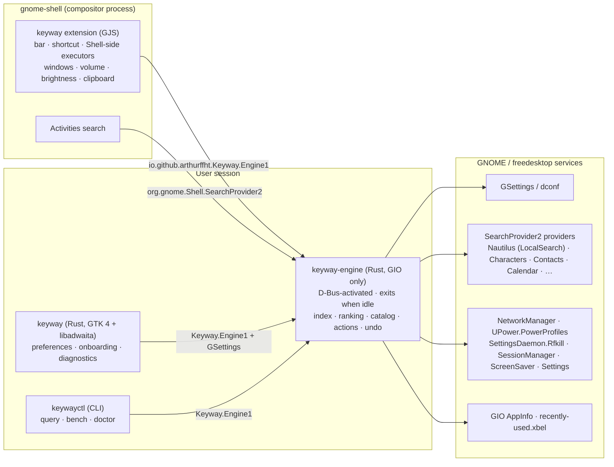

# Architecture overview

Summary of [PLAN.md Part II](PLAN.md#part-ii--architecture). Component documents are added here as components are built.

| Component | Language | Owns | Never does |
|---|---|---|---|
| Extension | GJS (ESM) | The bar UI, the shortcut, modal grab, rendering, and Shell-side actions: launching apps, focusing windows, volume, brightness, clipboard observation | Indexing, ranking, file I/O, network, blocking calls |
| `keyway-engine` | Rust | Sources, normalization, matching, ranking, the catalog, action backends, undo, state, search provider | Linking GTK, drawing UI, keeping work on a timer |
| `keyway` | Rust | Settings UI, onboarding, diagnostics view | Executing actions (it always goes through the engine) |
| `keywayctl` | Rust | Scripted queries, benchmarks, health checks | Being required at runtime |

